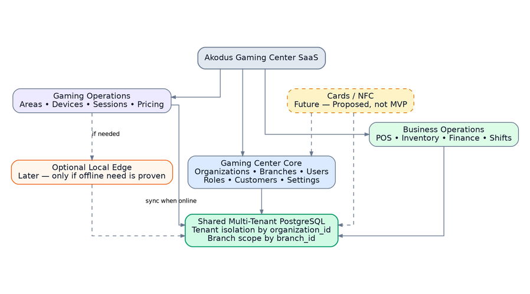
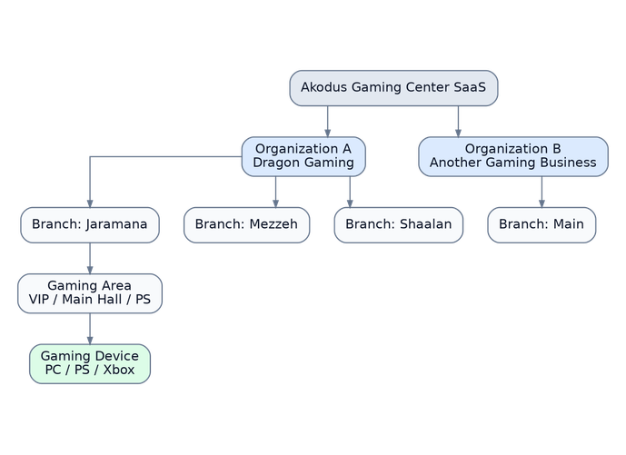
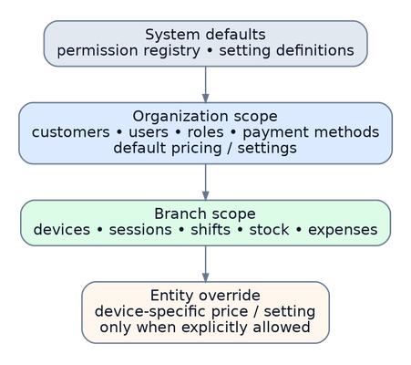
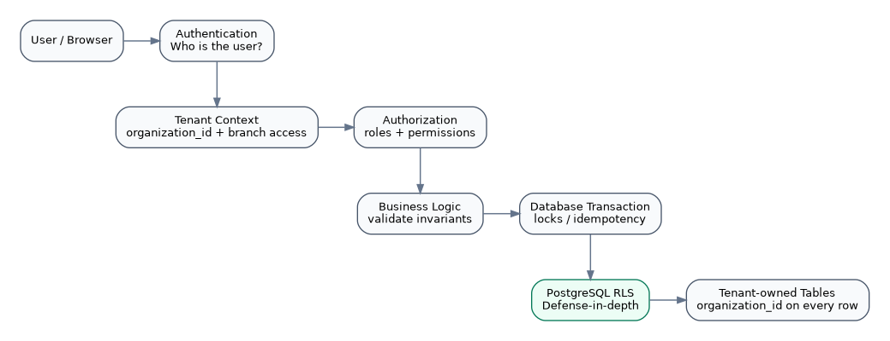
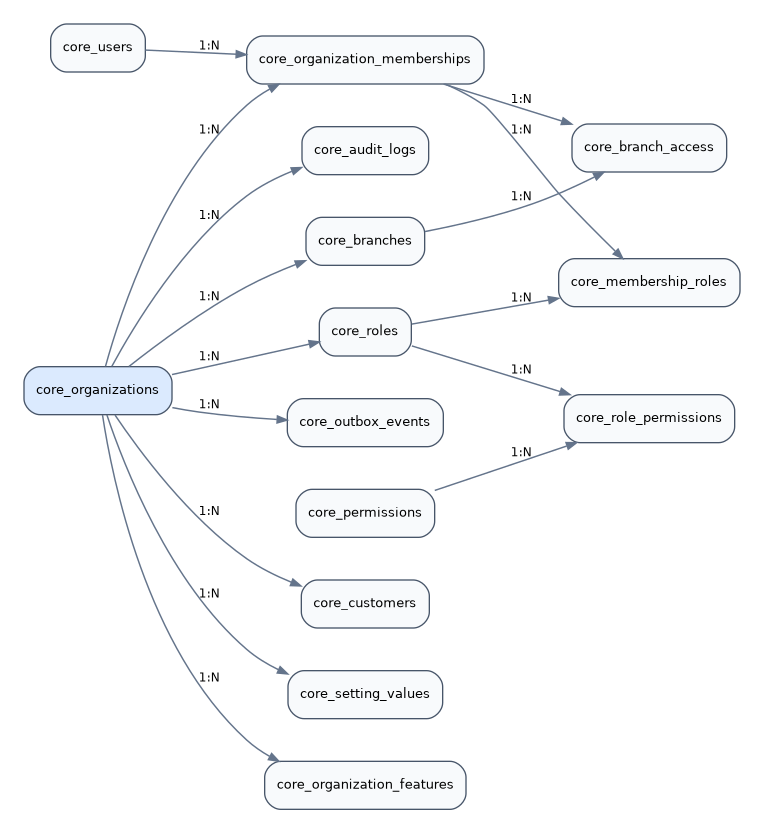
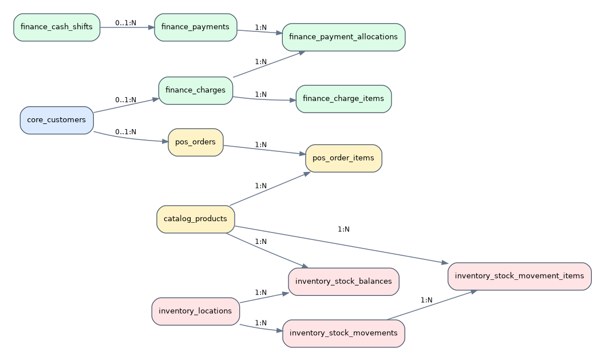
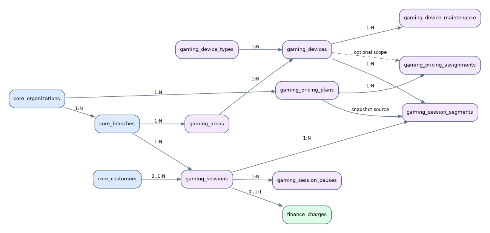
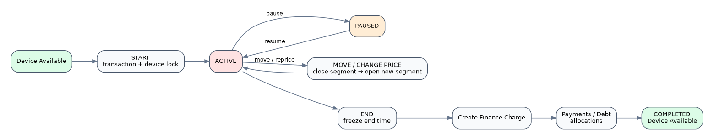
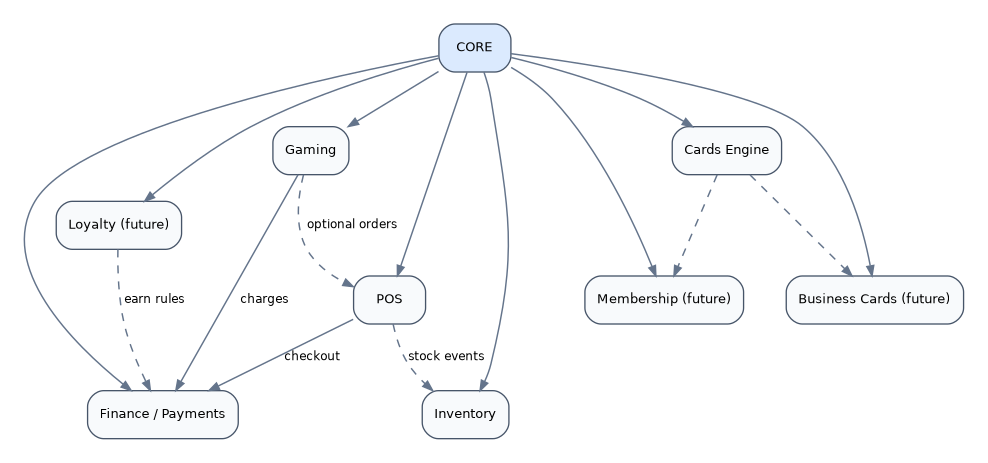

# Akodus Gaming Center — Architecture Blueprint (AI-readable)

> **Derived from** `Akodus_Gaming_Center_Database_Architecture_Blueprint_v1.1.docx`.
>
> The DOCX remains the **primary human-readable architecture source**.
>
> This Markdown document is the **implementation and AI-agent reference**.
>
> **Do not change architectural meaning during synchronization.**
>
> Diagrams were extracted from the DOCX as PNG files under `diagrams/`. They are visual; the tables and rules in this document remain authoritative.
>
> Source document: Akodus Gaming Center SaaS System & Database Architecture Blueprint v1.1 (24 August 2026). Language: Arabic with English technical terms.
>
> Figure 10 (`diagrams/figure-10.png`) is an additional extracted diagram from the DOCX with no explicit in-body caption; it is retained for fidelity.

---

AKODUS — GAMING CENTER
SaaS System & Database Architecture Blueprint
المخطط الشامل لنظام صالات الألعاب وقاعدة البيانات
Gaming Center Only • Multi-Tenant • Multi-Branch • PostgreSQL
Architecture Baseline v1.1
24 August 2026

| هدف الوثيقة — أن تكون المرجع التنفيذي الرسمي لنظام Akodus Gaming Center فقط، بحيث يستطيع أي مطوّر أو AI Agent فهم بنية النظام، قاعدة البيانات، العلاقات، قواعد الأمان وتسلسل التنفيذ بدون تخمين. قسم Cards/NFC محفوظ كامتداد مستقبلي قابل لإعادة التصميم، وليس جزءاً من MVP الحالي. |
| --- |

# 0. إدارة الوثيقة وطريقة استخدامها

| البند | القيمة |
| --- | --- |
| اسم الوثيقة | Akodus Gaming Center — SaaS System & Database Architecture Blueprint |
| الإصدار | v1.1 |
| الحالة | Architecture Baseline — أساس معتمد للتنفيذ مع نقاط Needs Decision محددة |
| قاعدة البيانات | PostgreSQL — إصدار مدعوم وحديث وقت النشر |
| لغة أسماء الجداول والحقول | English |
| لغة الشرح | العربية مع المصطلحات التقنية بالإنجليزية |
| نطاق المنتج | Gaming Center فقط — نظام SaaS لعدة شركات صالات ألعاب وفروعها |
| طريقة التطوير | Modular Monolith داخل Gaming Center + Shared Multi-Tenant PostgreSQL |
| حدود الوثيقة | لا تمثل Core عاماً لكل مشاريع Akodus. Cards/NFC مذكورة فقط كـ Future Extension للـGaming. |

دليل حالات القرارات:

| الحالة | المعنى |
| --- | --- |
| Approved / Baseline | قرار معماري يعتمد عليه التنفيذ الحالي. |
| MVP | مطلوب في أول إصدار قابل للاستخدام. |
| Phase 2 | مخطط لاحقاً ولا يجب أن يؤخر الـMVP. |
| Needs Decision | الخيار لم يُحسم بعد ويجب عدم افتراضه في الكود. |
| Under Research | الفكرة موجودة ولكن تحتاج تحقق Product/Technical قبل تنفيذها. |
| Future / Later — Proposed | تصور محفوظ للتوسع ولا ينفذ الآن؛ تفاصيله قابلة للتغيير قبل اعتماده. |

| قاعدة حاكمة — أي Agent أو مطوّر يجب أن يميز بين ما هو Business Configuration قابل للتعديل من النظام، وبين System Integrity التي يجب أن تبقى محمية بالكود والـDatabase Constraints. |
| --- |

# الفهرس

| # | القسم |
| --- | --- |
| 0 | إدارة الوثيقة وطريقة استخدامها |
| 1 | الملخص التنفيذي |
| 2 | مبادئ التصميم الحاكمة |
| 3 | نموذج الـTenancy والفروع |
| 4 | استراتيجية PostgreSQL المركزية |
| 5 | قواعد التسمية وأنواع البيانات |
| 6 | الأعمدة القياسية والـData Integrity |
| 7 | Gaming Center Core Data Model |
| 8 | Configuration Engine وFeature Flags |
| 9 | Authentication, Authorization & Branch Access |
| 10 | Customers, Guest Sessions & Customer Identity |
| 11 | Finance, Payments, Debt & Cash Shifts |
| 12 | Catalog & POS Module |
| 13 | Inventory Module |
| 14 | Gaming Operations — Implementation Blueprint |
| 15 | Later — Cards & NFC Integration (Proposed) |
| 16 | Multi-Tenant Security & PostgreSQL RLS |
| 17 | Indexing & Performance Strategy |

# الفهرس — تابع

| # | القسم |
| --- | --- |
| 18 | Money, Currency, Time & Pricing Accuracy |
| 19 | Transactions, Locks & Concurrency |
| 20 | Domain Events, Outbox & Realtime |
| 21 | Offline / Edge Readiness |
| 22 | Migrations, Backups & Disaster Recovery |
| 23 | Environments & Deployment Separation |
| 24 | Derived Data, Views & Reporting |
| 25 | Service Boundaries & API Contracts |
| 26 | Test Strategy |
| 27 | خطة التنفيذ خطوة بخطوة |
| 28 | تعليمات إلزامية لأي Developer أو AI Agent |
| 29 | Risk Register |
| 30 | MVP Database Scope |
| 31 | DDL Skeleton Examples |
| 32 | Glossary مبسط |
| 33 | مراجع تقنية |
| 34 | Next Decisions Before Coding Production |

# 1. الملخص التنفيذي

هذه الوثيقة مخصصة حصراً لنظام Akodus Gaming Center. النظام يعمل كـSaaS مشترك لعدة شركات صالات ألعاب: كل شركة/مالك صالات تمثل Organization (Tenant)، ويمكن أن تحتوي عدة Branches. قاعدة البيانات الأساسية Shared Multi-Tenant PostgreSQL مركزية واحدة مع عزل صارم باستخدام organization_id وbranch_id. لا تعتبر هذه الوثيقة Architecture عامة لبقية مشاريع Akodus. تكامل Cards/NFC مذكور لاحقاً فقط كامتداد مقترح للـGaming وقابل للتعديل قبل التنفيذ.

الشكل 1 — المعمارية العامة لنظام Akodus Gaming Center SaaS
الهدف هو بناء Gaming Center System عملي وسريع وآمن: يدير الأجهزة والجلسات والأسعار وPOS والمخزون والورديات والمدفوعات والعملاء عبر عدة فروع، مع أقل تعقيد ممكن في الـMVP وقابلية توسع مدروسة لاحقاً.

| قرار Baseline — الـCloud Database هي Source of Truth. لا ننشئ Database على جهاز كل عميل كخيار افتراضي. Offline Edge يضاف فقط لاحقاً للـModules التي تثبت حاجتها الفعلية مثل Gaming/POS. |
| --- |

## 1.1 القرارات المعمارية المعتمدة

Shared Multi-Tenant PostgreSQL بدلاً من Database مستقلة لكل عميل في الـMVP.
Multi-Organization وMulti-Branch من أول Migration.
Modular Monolith: تطبيق Gaming Center واحد منظم داخلياً إلى Core وGaming وFinance وPOS وInventory، بدون Microservices في البداية.
Configuration-Driven: الأسعار، أنواع الأجهزة، Areas، Payment Methods، التنبيهات، Feature Flags وغيرها تعدل من لوحة الإدارة.
كل Tenant-owned row تحتوي organization_id. وكل بيانات الفرع تحتوي branch_id أيضاً.
Customer على مستوى Organization وليس Branch، حتى يعمل نفس الحساب عبر الفروع.
Money يخزن بوحدات صحيحة Minor Units باستخدام bigint، وليس float.
الأحداث المالية المكتملة وAudit Logs لا تحذف ولا تعدل بطريقة تمس التاريخ.
Gaming Session تستخدم Segments لتوثيق تغييرات الجهاز أو السعر بدقة.
الـDebt لا يخزن كرقم قابل للتعديل يدوياً؛ يحسب من Charges غير المسددة.
Cloud-first مع تصميم IDs/Events يسمح بإضافة Offline Edge لاحقاً دون إعادة بناء الهوية الأساسية للبيانات.

## 1.2 قرارات تبقى Needs Decision

| القرار | لماذا لم نحسمه الآن | المعيار عند الاختيار |
| --- | --- | --- |
| ORM: Prisma vs Drizzle vs غيره | ليس ضرورياً لتثبيت الـData Model. | دعم PostgreSQL، Migrations، الأداء، Multi-schema/RLS، وتجربة التطوير. |
| Managed DB Provider | السعر والتوافر والموقع الجغرافي يتغيران. | PostgreSQL حقيقي، Backups/PITR، TLS، Monitoring، سهولة التوسع. |
| Authentication Provider | يمكن ربط الـCore بأكثر من مزود. | Security، MFA، Sessions، تكلفة، سهولة الـSaaS. |
| Realtime Transport | ليس جزءاً من الـDB schema نفسه. | WebSocket/SSE reliability والتكلفة. |
| Object Storage | لا نخزن الملفات الكبيرة داخل PostgreSQL. | S3-compatible، السعر، النسخ، التحكم بالصلاحيات. |
| Offline Edge Runtime | لا ننفذه قبل إثبات الحاجة. | انقطاع الإنترنت الفعلي وتأثيره التجاري على Gaming/POS. |

# 2. مبادئ التصميم الحاكمة

| Tenant Isolation First — الأمان ليس Filter في الواجهة. كل Query وRelation وConstraint يجب أن يحترم Organization الحالية. |
| --- |

| Configuration over Hardcoding — أي قاعدة عمل تتغير بين العملاء يجب أن تكون Data/Settings قدر الإمكان، لا if-statements خاصة بكل عميل. |
| --- |

| Relational First — العلاقات الأساسية تخزن كأعمدة وForeign Keys. jsonb يستخدم للبيانات المرنة والسجلات Snapshots، وليس بديلاً عن التصميم العلاقي. |
| --- |

| Immutable Financial History — بعد إكمال Payment/Charge لا نغير التاريخ لإصلاحه؛ ننشئ Refund/Adjustment موثق. |
| --- |

| Explicit Scope — كل Entity معروف هل هو System-global أو Organization أو Branch أو Entity override. |
| --- |

| No Premature Scale Tricks — لا Partitioning ولا Microservices ولا DB-per-tenant قبل الحاجة. نضع مسار توسع واضح فقط. |
| --- |

| Auditability — أي تغيير حساس يجب أن يترك أثراً: من قام به، متى، ماذا تغير، وفي أي فرع. |
| --- |

| Concurrency Safe — العمليات التي يمكن أن تحدث بنفس اللحظة مثل تشغيل نفس الجهاز أو خصم المخزون يجب أن تحسم داخل Transaction وConstraints. |
| --- |

# 3. نموذج الـTenancy والفروع

الشكل 2 — التسلسل: Gaming Center SaaS → Gaming Business → Branch → Area → Device

## 3.1 تعريف المصطلحات

| المصطلح | التعريف | مثال |
| --- | --- | --- |
| System | نظام Akodus Gaming Center SaaS نفسه ويخدم عدة Gaming Organizations (Tenants). | Akodus Gaming Center |
| Organization / Tenant | العميل التجاري الذي يستخدم النظام. | Dragon Gaming |
| Branch | فرع أو موقع تابع لنفس Organization. | Jaramana Branch |
| Area | قسم تشغيلي داخل الفرع. | VIP / Main Hall |
| User | هوية شخص تسجل الدخول، وقد تنتمي لأكثر من Organization مستقبلاً. | Owner / Cashier |
| Organization Membership | ربط User/موظف بـOrganization وصلاحياته فيها؛ ليست عضوية عميل. | User X عضو في Dragon Gaming |
| Customer | عميل Organization ويكون مشتركاً بين فروعها. | لاعب/عضو/زبون |

الشكل 3 — مستويات ملكية البيانات والإعدادات

## 3.2 Data Scope Matrix

| Entity | Scope | organization_id | branch_id | ملاحظة |
| --- | --- | --- | --- | --- |
| Permission registry | System | No | No | تعريفات ثابتة يسجلها Gaming Center Core وأقسام Gaming/POS/Inventory/Finance. |
| Organization | System record | N/A | No | هو الـTenant نفسه. |
| Branch | Organization | Yes | N/A | الفرع ينتمي إلى Organization واحدة. |
| Customer | Organization | Yes | Optional creator branch | يظهر عبر فروع المؤسسة. |
| Role | Organization | Yes | No | الدور قابل للتخصيص داخل المؤسسة. |
| Gaming Device | Branch | Yes | Yes | لا ينتقل بين Organizations. |
| Gaming Session | Branch | Yes | Yes | تاريخ مالي وتشغيلي للفرع. |
| Product | Organization | Yes | No | منتج مشترك، والسعر/التوفر يمكن تخصيصه للفرع. |
| Inventory Balance | Branch/Location | Yes | Yes | المخزون فعلياً في موقع معين. |
| Card (Future / Later) | Organization | Yes | Usually No | غير موجود في MVP؛ تخطيط أولي لتكامل Cards/NFC مستقبلاً. |
| Audit Log | Org + optional Branch | Yes | Optional | سجل غير قابل للتلاعب. |

# 4. استراتيجية PostgreSQL المركزية

تعمل PostgreSQL كذاكرة موثوقة للنظام. الـFrontend لا يمتلك صلاحيات إدارية على القاعدة. المسار الطبيعي: Browser → Backend/API → Authorization → Transaction → PostgreSQL. إذا استخدمنا مزوداً يسمح Direct Data APIs، يجب أن تكون RLS فعالة ولا تستخدم أي Service/Admin key في المتصفح.

الشكل 4 — مسار أي Request حساس قبل الوصول للبيانات

## 4.1 لماذا Shared Database؟

| الميزة | الأثر |
| --- | --- |
| Migration واحدة | أي تحديث Schema يطبق مرة واحدة على المنصة. |
| Backup/Monitoring مركزي | تشغيل أبسط وأقل تكلفة من مئات القواعد. |
| Onboarding سريع | إنشاء Organization لا يحتاج Provisioning لقاعدة جديدة. |
| Cross-branch طبيعي | كل فروع المؤسسة موجودة بنفس الـSource of Truth. |
| قابل للتوسع | يمكن لاحقاً نقل Enterprise Tenant إلى Dedicated DB إذا أصبح ذلك ضرورياً. |

## 4.2 الخطر الرئيسي وكيف نعالجه

| الخطر — Bug في Tenant filtering قد يسبب Cross-Tenant Data Leak؛ هذا أعلى Risk في Shared DB. |
| --- |

organization_id NOT NULL على كل Tenant-owned table.
Authorization على Backend قبل تنفيذ Query.
RLS في PostgreSQL كطبقة Defense-in-Depth عندما تكون طريقة الاتصال مناسبة.
Composite Foreign Keys تمنع ربط Record في Organization A بـBranch/Entity في Organization B.
Automated tenant-isolation tests في CI لكل Module.
عدم استخدام Database owner أو BYPASSRLS role في مسار Requests العادي.

# 5. قواعد التسمية وأنواع البيانات

## 5.1 Naming Convention

| العنصر | القاعدة | مثال |
| --- | --- | --- |
| Tables | snake_case مع Module prefix | gaming_sessions |
| Columns | snake_case | organization_id |
| Primary key | id | id uuid |
| Foreign key | <entity>_id | branch_id |
| Timestamps | *_at | created_at, ended_at |
| Boolean | is_* / has_* / allow_* | is_active |
| Codes | code | VIP_PC |
| Statuses | status نص مضبوط بـCHECK أو lookup | ACTIVE |
| Indexes | idx_<table>_<columns> | idx_gaming_sessions_org_branch_started |
| Unique | uq_<table>_<columns> | uq_core_branches_org_code |

## 5.2 أنواع البيانات المفضلة

| الحالة | PostgreSQL Type | القاعدة |
| --- | --- | --- |
| IDs | uuid | UUIDv7 مفضل إن توفر، UUIDv4 fallback. لا نعتمد auto-increment للـpublic/distributed entities. |
| Instant timestamps | timestamptz | نخزن اللحظة الفعلية UTC ويعرض التطبيق حسب Timezone. |
| Calendar date | date | للتواريخ بدون وقت. |
| Local schedule time | time | مثلاً ساعات عرض/دوام محلية. |
| Money | bigint + currency char(3) | المبلغ Minor Units. ممنوع float. |
| Inventory quantity | numeric(18,3) | يدعم وحدات كسرية إن احتجنا. |
| Flexible config | jsonb | فقط عندما تكون البنية مرنة ومتحقق منها من التطبيق. |
| Names/descriptions | text | نستخدم length constraint عندما يوجد سبب Business حقيقي. |
| Status | text + CHECK غالباً | أسهل في الـMigrations من DB Enum للحالات التي قد تتوسع. |

| UUID — PostgreSQL الحالي يدعم نوع uuid، وإصدارات حديثة تدعم توليد UUIDv7. للتوافق مع Edge مستقبلاً يمكن توليد UUIDv7 في التطبيق، مع بقاء العمود uuid. |
| --- |

# 6. الأعمدة القياسية والـData Integrity

## 6.1 Tenant-owned base columns

id uuid PRIMARY KEY
organization_id uuid NOT NULL
created_at timestamptz NOT NULL DEFAULT now()
updated_at timestamptz NOT NULL DEFAULT now()
Branch-owned tables تضيف branch_id. الجداول الحساسة تضيف created_by/updated_by. لا نضيف updated_by لسجلات Immutable إذا كانت لا تعدل أصلاً.

## 6.2 Composite Tenant Foreign Key Pattern

الهدف: حتى لو أخطأ التطبيق وأرسل branch_id من Tenant آخر، القاعدة نفسها ترفض العلاقة.
-- core_branches
UNIQUE (id, organization_id)

-- gaming_devices
FOREIGN KEY (branch_id, organization_id)
  REFERENCES core_branches (id, organization_id)

## 6.3 Delete Policy

| نوع البيانات | السياسة |
| --- | --- |
| Financial / Audit / Completed Session | لا Hard Delete. نستخدم status أو reversal/refund. |
| Master Data مستخدمة تاريخياً | Archive/Disable بدلاً من حذف يفسد Foreign Keys. |
| Draft غير مستخدم | يمكن Hard Delete بصلاحية مناسبة. |
| Personal data | يتم وضع سياسة anonymization/retention قانونية عند تحديد السوق والمتطلبات. |

# 7. Gaming Center Core Data Model

الشكل 5 — العلاقات الأساسية في Gaming Center Core
الجداول التالية هي Core الخاص بنظام Gaming Center: Organizations، Branches، Users، Customers، Permissions، Settings وغيرها. أقسام Gaming وFinance وPOS وInventory تعتمد عليها ولا تعيد تعريفها.
ملاحظة تسمية — core_organization_memberships تعني عضوية User/موظف داخل Organization لتحديد الوصول والصلاحيات، وليست Membership خاصة بعملاء الصالة أو الكروت.

### core_organizations

النطاق: System → Tenant  |  الحالة: MVP
يمثل عميل SaaS واحداً ويحدد الإعدادات الافتراضية العامة.

| Column | Type | Rules / Keys | الهدف |
| --- | --- | --- | --- |
| id | uuid | PK | المعرف الداخلي. |
| slug | text | UNIQUE, NOT NULL | معرف نصي مناسب للروابط والإدارة. |
| name | text | NOT NULL | الاسم الظاهر. |
| legal_name | text | NULL | الاسم القانوني إن وجد. |
| status | text | CHECK: ACTIVE/SUSPENDED/ARCHIVED | حالة الـTenant. |
| default_currency | char(3) | NOT NULL | ISO currency code مثل SYP. |
| timezone | text | NOT NULL | Timezone IANA. |
| locale | text | NOT NULL | لغة/Locale افتراضية. |
| created_at | timestamptz | NOT NULL | وقت الإنشاء. |
| updated_at | timestamptz | NOT NULL | آخر تعديل. |
| archived_at | timestamptz | NULL | أرشفة بدون حذف. |

الفهارس والقيود الأساسية:
UNIQUE(slug)
ملاحظات تنفيذية:
لا نضع Subscription billing logic داخل هذا الجدول؛ يضاف Module منفصل لاحقاً.

### core_branches

النطاق: Organization  |  الحالة: MVP
فروع Organization الواحدة.

| Column | Type | Rules / Keys | الهدف |
| --- | --- | --- | --- |
| id | uuid | PK | معرف الفرع. |
| organization_id | uuid | FK, NOT NULL | Tenant المالك. |
| code | text | NOT NULL | كود داخلي قصير. |
| name | text | NOT NULL | اسم الفرع. |
| status | text | CHECK | ACTIVE/INACTIVE/ARCHIVED. |
| timezone | text | NULL | Override إذا اختلف عن المؤسسة. |
| address_text | text | NULL | عنوان للعرض/الفاتورة. |
| phone | text | NULL | هاتف الفرع. |
| created_at | timestamptz | NOT NULL | إنشاء. |
| updated_at | timestamptz | NOT NULL | تعديل. |
| archived_at | timestamptz | NULL | أرشفة. |

الفهارس والقيود الأساسية:
UNIQUE(organization_id, code)
UNIQUE(id, organization_id) لدعم Composite FKs
ملاحظات تنفيذية:
كل Branch-owned table يجب أن يطابق organization_id للفرع.

### core_users

النطاق: System identity  |  الحالة: MVP
هوية الشخص التقنية، مستقلة عن Organization.

| Column | Type | Rules / Keys | الهدف |
| --- | --- | --- | --- |
| id | uuid | PK | معرف المستخدم. |
| auth_subject | text | UNIQUE, NOT NULL | المعرف من نظام Authentication. |
| email | text | NULL, indexed | البريد إن توفر. |
| display_name | text | NOT NULL | الاسم الظاهر. |
| status | text | CHECK | ACTIVE/BLOCKED/ARCHIVED. |
| last_login_at | timestamptz | NULL | آخر دخول. |
| created_at | timestamptz | NOT NULL | إنشاء. |

الفهارس والقيود الأساسية:
UNIQUE(auth_subject)
INDEX(lower(email)) إن كان البحث مطلوباً
ملاحظات تنفيذية:
لا نخزن Password hash هنا إذا Authentication Provider يديره خارج قاعدة التطبيق.

### core_organization_memberships

النطاق: Organization  |  الحالة: MVP
يربط User بـOrganization.

| Column | Type | Rules / Keys | الهدف |
| --- | --- | --- | --- |
| id | uuid | PK | معرف العضوية. |
| organization_id | uuid | FK, NOT NULL | Tenant. |
| user_id | uuid | FK, NOT NULL | User. |
| status | text | CHECK | INVITED/ACTIVE/SUSPENDED. |
| joined_at | timestamptz | NULL | تاريخ التفعيل. |
| created_at | timestamptz | NOT NULL | إنشاء. |

الفهارس والقيود الأساسية:
UNIQUE(organization_id, user_id)
INDEX(user_id, status)
ملاحظات تنفيذية:
Role وBranch access لا يوضعان مباشرة على user لتجنب تقييده بفرع واحد.

### core_roles

النطاق: Organization  |  الحالة: MVP
Role قابلة للتخصيص داخل Organization.

| Column | Type | Rules / Keys | الهدف |
| --- | --- | --- | --- |
| id | uuid | PK | المعرف. |
| organization_id | uuid | FK, NOT NULL | Tenant. |
| code | text | NOT NULL | كود ثابت داخل المؤسسة. |
| name | text | NOT NULL | الاسم الظاهر. |
| description | text | NULL | شرح. |
| is_system | boolean | NOT NULL DEFAULT false | هل أنشأها النظام كبداية. |
| status | text | CHECK | ACTIVE/ARCHIVED. |
| created_at | timestamptz | NOT NULL | إنشاء. |

الفهارس والقيود الأساسية:
UNIQUE(organization_id, code)
ملاحظات تنفيذية:
Owner/Manager/Cashier Templates وليست Roles hard-coded نهائياً.

### core_permissions

النطاق: System registry  |  الحالة: MVP
سجل permissions التي يعرفها الـCore والـModules.

| Column | Type | Rules / Keys | الهدف |
| --- | --- | --- | --- |
| code | text | PK | مثل gaming.sessions.start. |
| module | text | NOT NULL | gaming / pos / core. |
| name | text | NOT NULL | اسم بشري. |
| description | text | NULL | شرح الصلاحية. |
| risk_level | text | CHECK | LOW/MEDIUM/HIGH. |

الفهارس والقيود الأساسية:
INDEX(module)
ملاحظات تنفيذية:
كل Module يسجل Permissions الخاصة به عبر Seed/Migration.

### core_role_permissions

النطاق: Organization  |  الحالة: MVP
ربط Role بمجموعة Permissions.

| Column | Type | Rules / Keys | الهدف |
| --- | --- | --- | --- |
| organization_id | uuid | FK, NOT NULL | Tenant. |
| role_id | uuid | FK, NOT NULL | Role. |
| permission_code | text | FK, NOT NULL | Permission. |
| created_at | timestamptz | NOT NULL | وقت الإضافة. |

الفهارس والقيود الأساسية:
PRIMARY/UNIQUE(role_id, permission_code)
INDEX(organization_id, role_id)
ملاحظات تنفيذية:
RLS تعتمد organization_id؛ يجب التحقق أن role يتبع نفس المؤسسة.

### core_membership_roles

النطاق: Organization  |  الحالة: MVP
يسمح لعضو بأكثر من Role.

| Column | Type | Rules / Keys | الهدف |
| --- | --- | --- | --- |
| organization_id | uuid | FK, NOT NULL | Tenant. |
| membership_id | uuid | FK, NOT NULL | Organization Membership (User access). |
| role_id | uuid | FK, NOT NULL | Role. |
| created_at | timestamptz | NOT NULL | إنشاء. |

الفهارس والقيود الأساسية:
UNIQUE(membership_id, role_id)
ملاحظات تنفيذية:
Effective permissions = union of allowed roles مع قواعد deny إن أضفناها لاحقاً.

### core_branch_access

النطاق: Organization / Branch  |  الحالة: MVP
يحدد الفروع التي يمكن للعضو الوصول إليها.

| Column | Type | Rules / Keys | الهدف |
| --- | --- | --- | --- |
| organization_id | uuid | FK, NOT NULL | Tenant. |
| membership_id | uuid | FK, NOT NULL | Organization Membership (User access). |
| branch_id | uuid | FK, NOT NULL | Branch. |
| access_mode | text | CHECK | VIEW/OPERATE/MANAGE أو نموذج أبسط حسب implementation. |
| created_at | timestamptz | NOT NULL | إنشاء. |

الفهارس والقيود الأساسية:
UNIQUE(membership_id, branch_id)
ملاحظات تنفيذية:
Role ≠ Branch Access؛ الفصل ضروري لمدير يعمل في فرعين فقط.

### core_settings_definitions

النطاق: System registry  |  الحالة: MVP
يعرف Settings المتاحة وأنواعها وقواعدها.

| Column | Type | Rules / Keys | الهدف |
| --- | --- | --- | --- |
| key | text | PK | مثل gaming.billing_unit_seconds. |
| module | text | NOT NULL | الـModule المالك. |
| data_type | text | CHECK | STRING/NUMBER/BOOLEAN/SELECT/MONEY/JSON/... |
| default_value | jsonb | NULL | Default. |
| validation_schema | jsonb | NULL | حدود وقيم مسموحة. |
| scope_policy | text | NOT NULL | ORG/BRANCH/ENTITY أو combinations. |
| is_sensitive | boolean | NOT NULL | هل تحتاج masking/encryption. |
| description | text | NULL | شرح للإدارة. |

الفهارس والقيود الأساسية:
INDEX(module)
ملاحظات تنفيذية:
التعريفات تأتي من migrations/code؛ القيم تأتي من UI.

### core_setting_values

النطاق: Organization + scoped  |  الحالة: MVP
قيمة Setting فعلية مع inheritance.

| Column | Type | Rules / Keys | الهدف |
| --- | --- | --- | --- |
| id | uuid | PK | المعرف. |
| organization_id | uuid | FK, NOT NULL | Tenant. |
| branch_id | uuid | NULL | للفهرسة والسياق عندما Scope فرع/Entity. |
| scope_type | text | CHECK | ORGANIZATION/BRANCH/ENTITY. |
| scope_id | uuid | NOT NULL | ID للـscope. |
| setting_key | text | FK, NOT NULL | تعريف Setting. |
| value | jsonb | NOT NULL | القيمة بعد validation. |
| created_at | timestamptz | NOT NULL | إنشاء. |
| updated_at | timestamptz | NOT NULL | تعديل. |

الفهارس والقيود الأساسية:
UNIQUE(organization_id, scope_type, scope_id, setting_key)
INDEX(organization_id, branch_id, setting_key)
ملاحظات تنفيذية:
Resolution order المقترح: Entity → Branch → Organization → Definition default.

### core_features

النطاق: System registry  |  الحالة: MVP
Feature flags المعروفة لنظام Gaming Center.

| Column | Type | Rules / Keys | الهدف |
| --- | --- | --- | --- |
| code | text | PK | مثل gaming.reservations. |
| module | text | NOT NULL | Module. |
| description | text | NULL | شرح. |
| default_enabled | boolean | NOT NULL | Default للعميل الجديد. |

الفهارس والقيود الأساسية:
INDEX(module)
ملاحظات تنفيذية:
Feature Flag يحدد وجود الميزة؛ Setting يحدد سلوكها.

### core_organization_features

النطاق: Organization  |  الحالة: MVP
حالة Features لكل Tenant.

| Column | Type | Rules / Keys | الهدف |
| --- | --- | --- | --- |
| organization_id | uuid | FK, NOT NULL | Tenant. |
| feature_code | text | FK, NOT NULL | Feature. |
| enabled | boolean | NOT NULL | تشغيل/إيقاف. |
| config | jsonb | NULL | Configuration صغيرة خاصة بالتفعيل إن لزم. |
| updated_at | timestamptz | NOT NULL | تعديل. |

الفهارس والقيود الأساسية:
UNIQUE(organization_id, feature_code)
ملاحظات تنفيذية:
قد ترتبط لاحقاً بخطة SaaS لكن لا نخلط Billing في الـMVP.

### core_customers

النطاق: Organization  |  الحالة: MVP
Customer مشتركة بين فروع Organization.

| Column | Type | Rules / Keys | الهدف |
| --- | --- | --- | --- |
| id | uuid | PK | المعرف. |
| organization_id | uuid | FK, NOT NULL | Tenant. |
| customer_code | text | NULL | كود بشري اختياري. |
| display_name | text | NOT NULL | الاسم. |
| phone_normalized | text | NULL, indexed | هاتف بصيغة موحدة. |
| email_normalized | text | NULL, indexed | البريد. |
| status | text | CHECK | ACTIVE/BLOCKED/ARCHIVED. |
| notes | text | NULL | ملاحظات داخلية. |
| created_branch_id | uuid | NULL | الفرع الذي أنشأ السجل. |
| created_by | uuid | NULL FK user | الموظف. |
| created_at | timestamptz | NOT NULL | إنشاء. |
| updated_at | timestamptz | NOT NULL | تعديل. |

الفهارس والقيود الأساسية:
INDEX(organization_id, phone_normalized)
INDEX(organization_id, display_name)
لا نضع UNIQUE على الهاتف افتراضياً قبل Validation تجاري
ملاحظات تنفيذية:
الزيارات والمصروف والساعات Metrics مشتقة من Sessions/Orders ولا تخزن كحقائق يدوية.

### core_files

النطاق: Organization  |  الحالة: MVP
Metadata للملفات المخزنة خارج PostgreSQL.

| Column | Type | Rules / Keys | الهدف |
| --- | --- | --- | --- |
| id | uuid | PK | المعرف. |
| organization_id | uuid | FK, NOT NULL | Tenant. |
| branch_id | uuid | NULL | Scope اختياري. |
| owner_type | text | NOT NULL | Entity type. |
| owner_id | uuid | NOT NULL | Entity id. |
| storage_key | text | UNIQUE, NOT NULL | مسار Object Storage. |
| original_name | text | NOT NULL | اسم الملف. |
| mime_type | text | NOT NULL | MIME. |
| size_bytes | bigint | NOT NULL | الحجم. |
| checksum | text | NULL | سلامة/duplicate detection. |
| created_by | uuid | NULL | Uploader. |
| created_at | timestamptz | NOT NULL | إنشاء. |

الفهارس والقيود الأساسية:
INDEX(organization_id, owner_type, owner_id)
ملاحظات تنفيذية:
لا نخزن Binary file نفسه داخل الجدول.

### core_audit_logs

النطاق: Organization + optional Branch  |  الحالة: MVP
سجل Append-only للتغييرات الحساسة.

| Column | Type | Rules / Keys | الهدف |
| --- | --- | --- | --- |
| id | uuid | PK | Event ID. |
| organization_id | uuid | FK, NOT NULL | Tenant. |
| branch_id | uuid | NULL | Branch context. |
| actor_user_id | uuid | NULL | المستخدم أو system. |
| action | text | NOT NULL | مثل gaming.session.discount. |
| entity_type | text | NOT NULL | نوع الهدف. |
| entity_id | uuid | NULL | ID الهدف. |
| before_data | jsonb | NULL | Snapshot قبل. |
| after_data | jsonb | NULL | Snapshot بعد. |
| metadata | jsonb | NULL | IP/session/reason عند الحاجة. |
| created_at | timestamptz | NOT NULL | وقت الحدث. |

الفهارس والقيود الأساسية:
INDEX(organization_id, created_at DESC)
INDEX(organization_id, entity_type, entity_id, created_at DESC)
ملاحظات تنفيذية:
لا UPDATE/DELETE من التطبيق. يمكن Partitioning زمنياً لاحقاً إذا كبر الحجم.

### core_outbox_events

النطاق: Organization  |  الحالة: MVP
Reliable domain-event outbox داخل نفس Transaction.

| Column | Type | Rules / Keys | الهدف |
| --- | --- | --- | --- |
| id | uuid | PK | Event ID. |
| organization_id | uuid | FK, NOT NULL | Tenant. |
| branch_id | uuid | NULL | Context. |
| event_type | text | NOT NULL | gaming.session.completed مثلاً. |
| aggregate_type | text | NOT NULL | نوع المصدر. |
| aggregate_id | uuid | NOT NULL | ID المصدر. |
| payload | jsonb | NOT NULL | Event payload versioned. |
| occurred_at | timestamptz | NOT NULL | وقت الحدث. |
| published_at | timestamptz | NULL | هل تم النشر. |
| attempts | integer | NOT NULL DEFAULT 0 | Retry count. |
| last_error | text | NULL | آخر خطأ. |

الفهارس والقيود الأساسية:
INDEX(published_at, occurred_at)
INDEX(organization_id, event_type, occurred_at DESC)
ملاحظات تنفيذية:
لا نحتاج Message Broker في الـMVP؛ Outbox يسمح إضافته لاحقاً.

### core_idempotency_keys

النطاق: Organization  |  الحالة: MVP
يمنع تكرار العمليات الحساسة عند retries.

| Column | Type | Rules / Keys | الهدف |
| --- | --- | --- | --- |
| id | uuid | PK | المعرف. |
| organization_id | uuid | FK, NOT NULL | Tenant. |
| scope | text | NOT NULL | مثلاً payments.create. |
| idempotency_key | text | NOT NULL | Key من العميل/الخدمة. |
| request_hash | text | NULL | يكشف إعادة استخدام نفس key بطلب مختلف. |
| response_code | integer | NULL | نتيجة محفوظة. |
| response_body | jsonb | NULL | النتيجة عند الحاجة. |
| created_at | timestamptz | NOT NULL | إنشاء. |
| expires_at | timestamptz | NOT NULL | تنظيف لاحق. |

الفهارس والقيود الأساسية:
UNIQUE(organization_id, scope, idempotency_key)
INDEX(expires_at)
ملاحظات تنفيذية:
ضروري لPayments وEdge sync وعمليات يمكن للمتصفح إعادة إرسالها.

# 8. Configuration Engine وFeature Flags

هذا الجزء يحقق مبدأ: ليس كل اختلاف بين العملاء يحتاج كوداً. المطور يبني Capability مرة واحدة، ثم يحدد صاحب المؤسسة أو المدير القيم من النظام حسب Permissions.
Resolution example:
1. Device override
2. Branch override
3. Organization value
4. System default

| مثال | يجب أن يكون |
| --- | --- |
| gaming.billing_unit_seconds | Setting |
| gaming.allow_guest_sessions | Setting أو Feature حسب مستوى الإخفاء |
| gaming.reservations | Feature Flag |
| اسم Area | Business Data |
| سعر Plan | Business Data |
| منع تشغيل جهاز مستخدم مرتين | Core code + DB constraint |
| صلاحية الخصم | Permission |
| لون/Logo العميل | Branding Setting |

| ممنوع — إنشاء if (organizationId === "customer-x") لتخصيص عميل. أي تخصيص متكرر يجب أن يتحول Setting/Feature/Custom Field أو Module واضح. |
| --- |

# 9. Authentication, Authorization & Branch Access

Authentication يثبت من هو المستخدم. Authorization يقرر ماذا يستطيع أن يفعل. Branch Access يقرر أين يستطيع فعل ذلك. الثلاثة لا يجب خلطها.
User → Organization Membership → Roles → Permissions
                              ↘ Branch Access

| مثال Permission | Risk | ملاحظة |
| --- | --- | --- |
| gaming.sessions.start | MEDIUM | تشغيل جهاز وإنشاء التزام مالي. |
| gaming.sessions.cancel | HIGH | يحتاج reason + audit. |
| gaming.sessions.discount | HIGH | يمكن ربطه manager approval. |
| finance.payments.create | HIGH | يؤثر على الذمم والصندوق. |
| finance.shifts.close | HIGH | يوثق فرق الصندوق. |
| inventory.adjust | HIGH | يعدل كميات بدون بيع/شراء. |
| settings.manage | HIGH | قد يغير الأسعار وقواعد العمل. |
| reports.financial.view | MEDIUM/HIGH | بيانات مالية حساسة. |

# 10. Customers, Guest Sessions & Customer Identity

هذا القسم يثبت طريقة التعامل مع العميل داخل Gaming Center بدون إدخال الكروت في الـMVP. Customer هو سجل على مستوى Organization ويُستخدم عبر جميع الفروع. Gaming Session يمكن أن تكون Guest بدون إنشاء Customer.
قواعد أساسية:
Guest Session مسموحة بدون اسم أو هاتف عندما لا يحتاج التشغيل إلى حساب عميل.
Customer مسجل مرة واحدة على مستوى Organization، وليس نسخة منفصلة لكل Branch.
الدين أو أي مبلغ مؤجل يحتاج Customer معروف؛ Guest لا يترك Debt.
الربط الحالي بالعميل يتم بالبحث/الهاتف/الاختيار من النظام. Cards/NFC ليست شرطاً لتشغيل النظام.
إحصاءات مثل visits وgaming hours وtotal spend تشتق من Sessions/Charges/Payments ولا تعتمد على counters قابلة للتلاعب.
أي Customer Identification إضافي (NFC/QR/Card) يدخل لاحقاً كطبقة مستقلة بدون تغيير Session أو Finance core.

## Customer Profile — البيانات التشغيلية الأساسية

الـCustomer Profile يعرض معلومات الهوية والتواصل، الفروع التي زارها، Sessions، Orders، Payments، Debt الحالي، والملاحظات المسموحة. لا نخزن إحصاءات مشتقة كحقيقة نهائية إذا كان يمكن حسابها من Ledger/History.

## Guest → Registered Customer Conversion

إذا بدأ اللاعب كـGuest ثم قرر التسجيل قبل إغلاق الجلسة، يمكن Assign Customer للجلسة الحالية مع Audit. لا ننسخ Session ولا نعيد إنشاء Charge. هذا مهم لاحقاً أيضاً إذا تم التعرف على العميل بكرت NFC.

# 11. Finance, Payments, Debt & Cash Shifts

التصميم المالي يجب أن يسمح Cash وShamCash manual record وSplit Payment وDebt وRefund بدون field مبسط paid=true/false. لذلك نفصل Charge عن Payment عن Allocation.

الشكل 6 — علاقة Finance مع POS وInventory

| قاعدة محاسبية مهمة — Customer debt = مجموع الرصيد المتبقي على Charges المستحقة، وليس عمود debt_balance يمكن تغييره مباشرة. |
| --- |

### finance_payment_methods

النطاق: Organization  |  الحالة: MVP
طرق الدفع القابلة للتعديل.

| Column | Type | Rules / Keys | الهدف |
| --- | --- | --- | --- |
| id | uuid | PK | المعرف. |
| organization_id | uuid | FK, NOT NULL | Tenant. |
| code | text | NOT NULL | CASH/SHAMCASH/... |
| name | text | NOT NULL | الاسم الظاهر. |
| method_type | text | CHECK | CASH/MANUAL/INTEGRATED/WALLET. |
| requires_reference | boolean | NOT NULL | هل يلزم رقم مرجع. |
| status | text | CHECK | ACTIVE/INACTIVE. |
| config | jsonb | NULL | إعداد Integration إن وجد؛ الأسرار خارج DB أو مشفرة. |

الفهارس والقيود الأساسية:
UNIQUE(organization_id, code)
ملاحظات تنفيذية:
تسجيل ShamCash كطريقة دفع لا يعني وجود API integration. Integration تبقى Needs Verification.

### finance_charges

النطاق: Branch financial  |  الحالة: MVP
فاتورة/التزام مالي ناتج عن Gaming Session أو POS Order أو Adjustment مسموح داخل Gaming Center.

| Column | Type | Rules / Keys | الهدف |
| --- | --- | --- | --- |
| id | uuid | PK | المعرف. |
| organization_id | uuid | FK, NOT NULL | Tenant. |
| branch_id | uuid | FK, NOT NULL | Branch. |
| customer_id | uuid | NULL FK | Customer؛ مطلوب إذا بقي Debt. |
| source_module | text | NOT NULL | gaming / pos / manual_adjustment (MVP). Future extensions add values only when approved. |
| source_type | text | NOT NULL | نوع المصدر. |
| source_id | uuid | NOT NULL | ID المصدر. |
| status | text | CHECK | OPEN/PARTIALLY_PAID/PAID/VOID. |
| currency | char(3) | NOT NULL | العملة. |
| subtotal_minor | bigint | NOT NULL | قبل discounts/tax. |
| discount_minor | bigint | NOT NULL DEFAULT 0 | الخصم. |
| tax_minor | bigint | NOT NULL DEFAULT 0 | الضريبة إن وجدت. |
| total_minor | bigint | NOT NULL | المبلغ النهائي. |
| issued_at | timestamptz | NOT NULL | الإصدار. |
| due_at | timestamptz | NULL | استحقاق. |
| created_by | uuid | NULL | الموظف. |

الفهارس والقيود الأساسية:
UNIQUE(organization_id, source_module, source_type, source_id) إذا المصدر ينشئ Charge واحدة
INDEX(organization_id, customer_id, status, issued_at DESC)
ملاحظات تنفيذية:
Balance مستحق يحسب من total minus successful allocations/refunds وفق View/Query موحدة.

### finance_charge_items

النطاق: Branch financial  |  الحالة: MVP
تفاصيل Charge مع snapshots تاريخية.

| Column | Type | Rules / Keys | الهدف |
| --- | --- | --- | --- |
| id | uuid | PK | المعرف. |
| organization_id | uuid | FK, NOT NULL | Tenant. |
| charge_id | uuid | FK, NOT NULL | Charge. |
| item_type | text | NOT NULL | GAMING_TIME/POS_ITEM/DISCOUNT/etc. |
| description_snapshot | text | NOT NULL | الوصف وقت العملية. |
| quantity | numeric(18,3) | NOT NULL | الكمية. |
| unit_amount_minor | bigint | NOT NULL | السعر للوحدة. |
| total_minor | bigint | NOT NULL | الإجمالي. |
| source_type | text | NULL | مصدر التفاصيل. |
| source_id | uuid | NULL | ID المصدر. |
| metadata | jsonb | NULL | Snapshot تكميلي. |

الفهارس والقيود الأساسية:
INDEX(organization_id, charge_id)
ملاحظات تنفيذية:
لا يعاد حساب تاريخ قديم من سعر المنتج الحالي؛ التاريخ يعتمد على snapshot وقت البيع.

### finance_payments

النطاق: Branch financial  |  الحالة: MVP
دفع فعلي مستقل عن الفاتورة، ويسمح Split/Multiple allocations.

| Column | Type | Rules / Keys | الهدف |
| --- | --- | --- | --- |
| id | uuid | PK | Payment ID. |
| organization_id | uuid | FK, NOT NULL | Tenant. |
| branch_id | uuid | FK, NOT NULL | Branch. |
| customer_id | uuid | NULL FK | Customer. |
| payment_method_id | uuid | FK, NOT NULL | Method. |
| cash_shift_id | uuid | NULL FK | Shift إذا الدفع ضمن صندوق. |
| status | text | CHECK | PENDING/COMPLETED/VOIDED/PARTIALLY_REFUNDED/REFUNDED. |
| currency | char(3) | NOT NULL | العملة. |
| amount_minor | bigint | CHECK > 0 | المبلغ. |
| external_reference | text | NULL | مرجع ShamCash/غيره. |
| received_at | timestamptz | NOT NULL | وقت الاستلام. |
| created_by | uuid | FK, NOT NULL | الموظف. |
| created_at | timestamptz | NOT NULL | إنشاء. |

الفهارس والقيود الأساسية:
INDEX(organization_id, branch_id, received_at DESC)
INDEX(organization_id, external_reference)
ملاحظات تنفيذية:
Payment completion عملية idempotent. لا تعديل amount بعد COMPLETED؛ استخدم Refund.

### finance_payment_allocations

النطاق: Branch financial  |  الحالة: MVP
يربط مبلغ Payment بواحدة أو أكثر من Charges.

| Column | Type | Rules / Keys | الهدف |
| --- | --- | --- | --- |
| id | uuid | PK | المعرف. |
| organization_id | uuid | FK, NOT NULL | Tenant. |
| payment_id | uuid | FK, NOT NULL | Payment. |
| charge_id | uuid | FK, NOT NULL | Charge. |
| amount_minor | bigint | CHECK > 0 | المبلغ المخصص. |
| created_at | timestamptz | NOT NULL | وقت الربط. |

الفهارس والقيود الأساسية:
INDEX(payment_id)
INDEX(charge_id)
Constraint/service invariant: مجموع allocations لا يتجاوز Payment ولا Charge balance
ملاحظات تنفيذية:
يدعم 60k Cash + 40k ShamCash لنفس Charge، أو Payment واحد يسدد عدة Charges.

### finance_refunds

النطاق: Branch financial  |  الحالة: MVP
عملية عكس دفع موثقة.

| Column | Type | Rules / Keys | الهدف |
| --- | --- | --- | --- |
| id | uuid | PK | Refund ID. |
| organization_id | uuid | FK, NOT NULL | Tenant. |
| payment_id | uuid | FK, NOT NULL | Payment الأصلي. |
| amount_minor | bigint | CHECK > 0 | المبلغ. |
| reason | text | NOT NULL | السبب. |
| status | text | CHECK | PENDING/COMPLETED/FAILED. |
| processed_at | timestamptz | NULL | وقت الإكمال. |
| created_by | uuid | FK, NOT NULL | الموظف. |
| created_at | timestamptz | NOT NULL | إنشاء. |

الفهارس والقيود الأساسية:
INDEX(organization_id, payment_id)
ملاحظات تنفيذية:
مجموع Refunds المكتملة لا يتجاوز Payment amount.

### finance_expense_categories

النطاق: Organization  |  الحالة: MVP
تصنيفات المصاريف القابلة للتعديل.

| Column | Type | Rules / Keys | الهدف |
| --- | --- | --- | --- |
| id | uuid | PK | المعرف. |
| organization_id | uuid | FK, NOT NULL | Tenant. |
| code | text | NOT NULL | كود. |
| name | text | NOT NULL | اسم. |
| status | text | CHECK | ACTIVE/ARCHIVED. |

الفهارس والقيود الأساسية:
UNIQUE(organization_id, code)

### finance_expenses

النطاق: Branch financial  |  الحالة: MVP
مصروف فعلي داخل فرع.

| Column | Type | Rules / Keys | الهدف |
| --- | --- | --- | --- |
| id | uuid | PK | المعرف. |
| organization_id | uuid | FK, NOT NULL | Tenant. |
| branch_id | uuid | FK, NOT NULL | Branch. |
| category_id | uuid | FK, NOT NULL | Category. |
| cash_shift_id | uuid | NULL FK | Shift إن خرج من الصندوق. |
| payment_method_id | uuid | NULL FK | طريقة الدفع. |
| amount_minor | bigint | CHECK > 0 | المبلغ. |
| currency | char(3) | NOT NULL | العملة. |
| description | text | NOT NULL | التفصيل. |
| status | text | CHECK | POSTED/VOIDED. |
| occurred_at | timestamptz | NOT NULL | وقت المصروف. |
| created_by | uuid | FK, NOT NULL | الموظف. |
| created_at | timestamptz | NOT NULL | إنشاء. |

الفهارس والقيود الأساسية:
INDEX(organization_id, branch_id, occurred_at DESC)
ملاحظات تنفيذية:
Void يحتاج Permission + reason + Audit، لا حذف.

### finance_cash_shifts

النطاق: Branch financial  |  الحالة: MVP
وردية كاشير وصندوق.

| Column | Type | Rules / Keys | الهدف |
| --- | --- | --- | --- |
| id | uuid | PK | Shift ID. |
| organization_id | uuid | FK, NOT NULL | Tenant. |
| branch_id | uuid | FK, NOT NULL | Branch. |
| user_id | uuid | FK, NOT NULL | Cashier. |
| status | text | CHECK | OPEN/CLOSED. |
| opening_cash_minor | bigint | NOT NULL | رصيد بداية. |
| opened_at | timestamptz | NOT NULL | فتح. |
| closed_at | timestamptz | NULL | إغلاق. |
| expected_cash_minor | bigint | NULL | Snapshot عند الإغلاق. |
| closing_cash_minor | bigint | NULL | العد الفعلي. |
| difference_minor | bigint | NULL | closing - expected. |
| notes | text | NULL | ملاحظات. |

الفهارس والقيود الأساسية:
Partial UNIQUE(user_id, branch_id) WHERE status=OPEN أو rule حسب سياسة الفرع
INDEX(organization_id, branch_id, opened_at DESC)
ملاحظات تنفيذية:
هل يسمح بأكثر من Shift مفتوحة لنفس المستخدم/الصندوق يجب أن يكون Setting/Business rule.

### finance_cash_counts

النطاق: Branch financial  |  الحالة: MVP
توثيق عد الصندوق بدل تعديل Shift بلا أثر.

| Column | Type | Rules / Keys | الهدف |
| --- | --- | --- | --- |
| id | uuid | PK | المعرف. |
| organization_id | uuid | FK, NOT NULL | Tenant. |
| cash_shift_id | uuid | FK, NOT NULL | Shift. |
| count_type | text | CHECK | OPENING/CLOSING/RECOUNT. |
| total_minor | bigint | NOT NULL | الإجمالي. |
| details | jsonb | NULL | تفصيل فئات نقدية إن استخدم. |
| counted_by | uuid | FK, NOT NULL | الموظف. |
| counted_at | timestamptz | NOT NULL | وقت العد. |

الفهارس والقيود الأساسية:
INDEX(cash_shift_id, counted_at)
ملاحظات تنفيذية:
مفيد للتحقيق في فروقات الصندوق.

# 12. Catalog & POS Module

POS يجب أن يكون Reusable وليس Gaming-only. المنتجات Organization-level، بينما السعر والتوفر يمكن أن يختلفا حسب Branch.

### catalog_categories

النطاق: Organization  |  الحالة: MVP
تصنيف المنتجات.

| Column | Type | Rules / Keys | الهدف |
| --- | --- | --- | --- |
| id | uuid | PK | المعرف. |
| organization_id | uuid | FK, NOT NULL | Tenant. |
| parent_id | uuid | NULL FK self | تصنيف فرعي اختياري. |
| code | text | NULL | كود. |
| name | text | NOT NULL | الاسم. |
| status | text | CHECK | ACTIVE/ARCHIVED. |
| sort_order | integer | NOT NULL DEFAULT 0 | ترتيب UI. |

الفهارس والقيود الأساسية:
UNIQUE(organization_id, code) WHERE code IS NOT NULL

### catalog_products

النطاق: Organization  |  الحالة: MVP
Master product مشترك عبر الفروع.

| Column | Type | Rules / Keys | الهدف |
| --- | --- | --- | --- |
| id | uuid | PK | المعرف. |
| organization_id | uuid | FK, NOT NULL | Tenant. |
| category_id | uuid | NULL FK | Category. |
| sku | text | NULL | SKU. |
| barcode | text | NULL | Barcode. |
| name | text | NOT NULL | اسم. |
| product_type | text | CHECK | STOCK/SERVICE/NON_STOCK. |
| track_inventory | boolean | NOT NULL | هل يخصم stock. |
| base_cost_minor | bigint | NULL | تكلفة مرجعية. |
| status | text | CHECK | ACTIVE/ARCHIVED. |
| created_at | timestamptz | NOT NULL | إنشاء. |
| updated_at | timestamptz | NOT NULL | تعديل. |

الفهارس والقيود الأساسية:
UNIQUE(organization_id, sku) WHERE sku IS NOT NULL
INDEX(organization_id, barcode)
ملاحظات تنفيذية:
السعر لا نخزنه كحقيقة واحدة هنا إذا نحتاج Branch overrides.

### catalog_product_prices

النطاق: Organization/Branch  |  الحالة: MVP
Price history وBranch override.

| Column | Type | Rules / Keys | الهدف |
| --- | --- | --- | --- |
| id | uuid | PK | المعرف. |
| organization_id | uuid | FK, NOT NULL | Tenant. |
| product_id | uuid | FK, NOT NULL | Product. |
| branch_id | uuid | NULL FK | NULL = Organization default. |
| currency | char(3) | NOT NULL | العملة. |
| amount_minor | bigint | CHECK >= 0 | السعر. |
| valid_from | timestamptz | NOT NULL | بداية. |
| valid_to | timestamptz | NULL | نهاية. |
| is_active | boolean | NOT NULL | تفعيل. |

الفهارس والقيود الأساسية:
INDEX(organization_id, product_id, branch_id, valid_from DESC)
منع overlapping active prices عبر service/constraint strategy
ملاحظات تنفيذية:
Order item يأخذ snapshot للسعر وقت البيع.

### pos_orders

النطاق: Branch  |  الحالة: MVP
Order بيع مباشر أو مرتبط Gaming Session.

| Column | Type | Rules / Keys | الهدف |
| --- | --- | --- | --- |
| id | uuid | PK | Order ID. |
| organization_id | uuid | FK, NOT NULL | Tenant. |
| branch_id | uuid | FK, NOT NULL | Branch. |
| customer_id | uuid | NULL FK | Customer. |
| order_number | text | NOT NULL | رقم بشري داخل الفرع. |
| status | text | CHECK | DRAFT/OPEN/COMPLETED/CANCELLED. |
| subtotal_minor | bigint | NOT NULL | قبل الخصم. |
| discount_minor | bigint | NOT NULL DEFAULT 0 | خصم. |
| tax_minor | bigint | NOT NULL DEFAULT 0 | ضريبة. |
| total_minor | bigint | NOT NULL | Total. |
| opened_by | uuid | FK, NOT NULL | الموظف. |
| opened_at | timestamptz | NOT NULL | فتح. |
| completed_at | timestamptz | NULL | إكمال. |
| charge_id | uuid | NULL FK finance_charges | Charge إذا Checkout مستقل. |

الفهارس والقيود الأساسية:
UNIQUE(organization_id, branch_id, order_number)
INDEX(organization_id, branch_id, opened_at DESC)
ملاحظات تنفيذية:
إذا Order مرتبطة Session يمكن جمعها ضمن Charge الجلسة بدلاً من Charge منفصلة حسب flow.

### pos_order_items

النطاق: Branch  |  الحالة: MVP
Line items مع snapshots.

| Column | Type | Rules / Keys | الهدف |
| --- | --- | --- | --- |
| id | uuid | PK | المعرف. |
| organization_id | uuid | FK, NOT NULL | Tenant. |
| order_id | uuid | FK, NOT NULL | Order. |
| product_id | uuid | NULL FK | Product قد يؤرشف لاحقاً. |
| name_snapshot | text | NOT NULL | اسم وقت البيع. |
| sku_snapshot | text | NULL | SKU وقت البيع. |
| quantity | numeric(18,3) | CHECK > 0 | كمية. |
| unit_price_minor | bigint | CHECK >= 0 | السعر. |
| discount_minor | bigint | NOT NULL DEFAULT 0 | خصم line. |
| total_minor | bigint | NOT NULL | Final line total. |
| cost_snapshot_minor | bigint | NULL | تكلفة وقت البيع للتقارير. |

الفهارس والقيود الأساسية:
INDEX(organization_id, order_id)
INDEX(organization_id, product_id)
ملاحظات تنفيذية:
لا تعتمد تقارير الماضي على product الحالي.

# 13. Inventory Module

Inventory يحافظ على تاريخ Stock Movements. stock_balances جدول سريع للحالة الحالية، لكن كل تغيير له Movement موثق حتى يمكن تتبع السبب.

### inventory_locations

النطاق: Branch  |  الحالة: MVP
موقع مخزون داخل فرع.

| Column | Type | Rules / Keys | الهدف |
| --- | --- | --- | --- |
| id | uuid | PK | المعرف. |
| organization_id | uuid | FK, NOT NULL | Tenant. |
| branch_id | uuid | FK, NOT NULL | Branch. |
| code | text | NOT NULL | كود. |
| name | text | NOT NULL | اسم. |
| location_type | text | CHECK | STORE/WAREHOUSE/BAR/... |
| status | text | CHECK | ACTIVE/ARCHIVED. |

الفهارس والقيود الأساسية:
UNIQUE(organization_id, branch_id, code)

### inventory_stock_balances

النطاق: Branch/Location  |  الحالة: MVP
الرصيد الحالي السريع لكل Product/Location.

| Column | Type | Rules / Keys | الهدف |
| --- | --- | --- | --- |
| id | uuid | PK | المعرف. |
| organization_id | uuid | FK, NOT NULL | Tenant. |
| branch_id | uuid | FK, NOT NULL | Branch. |
| location_id | uuid | FK, NOT NULL | Location. |
| product_id | uuid | FK, NOT NULL | Product. |
| quantity_on_hand | numeric(18,3) | NOT NULL | الكمية الحالية. |
| quantity_reserved | numeric(18,3) | NOT NULL DEFAULT 0 | محجوز. |
| reorder_point | numeric(18,3) | NULL | Low stock threshold. |
| updated_at | timestamptz | NOT NULL | آخر حركة. |

الفهارس والقيود الأساسية:
UNIQUE(location_id, product_id)
INDEX(organization_id, branch_id, product_id)
ملاحظات تنفيذية:
تعديل الرصيد يتم داخل نفس Transaction التي تنشئ Movement، وليس مباشرة من UI.

### inventory_stock_movements

النطاق: Branch/Location  |  الحالة: MVP
Header لكل حركة مخزون.

| Column | Type | Rules / Keys | الهدف |
| --- | --- | --- | --- |
| id | uuid | PK | Movement ID. |
| organization_id | uuid | FK, NOT NULL | Tenant. |
| branch_id | uuid | FK, NOT NULL | Branch. |
| location_id | uuid | FK, NOT NULL | Location. |
| movement_type | text | CHECK | SALE/PURCHASE/ADJUSTMENT/TRANSFER_IN/TRANSFER_OUT/RETURN. |
| reference_type | text | NULL | pos_order/purchase/etc. |
| reference_id | uuid | NULL | ID المصدر. |
| notes | text | NULL | سبب/ملاحظات. |
| occurred_at | timestamptz | NOT NULL | وقت الحركة. |
| created_by | uuid | FK, NOT NULL | الموظف/system. |

الفهارس والقيود الأساسية:
INDEX(organization_id, branch_id, occurred_at DESC)
INDEX(reference_type, reference_id)
ملاحظات تنفيذية:
Movement بعد POSTED لا يعدل؛ corrective movement عند الخطأ.

### inventory_stock_movement_items

النطاق: Branch/Location  |  الحالة: MVP
تفاصيل الكميات في Movement.

| Column | Type | Rules / Keys | الهدف |
| --- | --- | --- | --- |
| id | uuid | PK | المعرف. |
| organization_id | uuid | FK, NOT NULL | Tenant. |
| movement_id | uuid | FK, NOT NULL | Movement. |
| product_id | uuid | FK, NOT NULL | Product. |
| quantity_delta | numeric(18,3) | NOT NULL != 0 | + دخول / - خروج. |
| unit_cost_minor | bigint | NULL | تكلفة مرجعية. |

الفهارس والقيود الأساسية:
INDEX(movement_id)
INDEX(organization_id, product_id)

### inventory_suppliers

النطاق: Organization  |  الحالة: MVP
الموردون.

| Column | Type | Rules / Keys | الهدف |
| --- | --- | --- | --- |
| id | uuid | PK | المعرف. |
| organization_id | uuid | FK, NOT NULL | Tenant. |
| code | text | NULL | كود. |
| name | text | NOT NULL | اسم. |
| phone | text | NULL | هاتف. |
| notes | text | NULL | ملاحظات. |
| status | text | CHECK | ACTIVE/ARCHIVED. |

الفهارس والقيود الأساسية:
UNIQUE(organization_id, code) WHERE code IS NOT NULL

### inventory_purchases

النطاق: Branch  |  الحالة: MVP
استلام مشتريات من مورد.

| Column | Type | Rules / Keys | الهدف |
| --- | --- | --- | --- |
| id | uuid | PK | المعرف. |
| organization_id | uuid | FK, NOT NULL | Tenant. |
| branch_id | uuid | FK, NOT NULL | Branch. |
| supplier_id | uuid | NULL FK | Supplier. |
| status | text | CHECK | DRAFT/RECEIVED/CANCELLED. |
| invoice_number | text | NULL | فاتورة المورد. |
| currency | char(3) | NOT NULL | عملة. |
| total_minor | bigint | NOT NULL | Total. |
| received_at | timestamptz | NULL | الاستلام. |
| created_by | uuid | FK, NOT NULL | الموظف. |
| created_at | timestamptz | NOT NULL | إنشاء. |

الفهارس والقيود الأساسية:
INDEX(organization_id, branch_id, created_at DESC)
ملاحظات تنفيذية:
عند RECEIVED تنشأ stock movement داخل Transaction واحدة.

### inventory_purchase_items

النطاق: Branch  |  الحالة: MVP
تفاصيل شراء.

| Column | Type | Rules / Keys | الهدف |
| --- | --- | --- | --- |
| id | uuid | PK | المعرف. |
| organization_id | uuid | FK, NOT NULL | Tenant. |
| purchase_id | uuid | FK, NOT NULL | Purchase. |
| product_id | uuid | FK, NOT NULL | Product. |
| quantity | numeric(18,3) | CHECK > 0 | كمية. |
| unit_cost_minor | bigint | CHECK >= 0 | تكلفة. |
| total_minor | bigint | NOT NULL | Total. |

الفهارس والقيود الأساسية:
INDEX(purchase_id)

| Phase 2 — Stock Transfer بين الفروع يحتاج workflow واضح (requested → shipped → received) وليس مجرد تعديل رصيدين. نضيف inventory_transfers وinventory_transfer_items عند تنفيذ الميزة. |
| --- |

# 14. Gaming Operations — Implementation Blueprint

هذا هو قلب نظام Gaming Center ونفصله Implementation-ready. الشاشة الأساسية Gaming Floor، لكن قاعدة البيانات تبنى حول Device state + Session lifecycle + Pricing snapshots + Finance integration.

الشكل 7 — ERD أساسي لـGaming Module

الشكل 8 — دورة حياة Gaming Session

### gaming_areas

النطاق: Branch  |  الحالة: MVP
قسم داخل صالة الألعاب.

| Column | Type | Rules / Keys | الهدف |
| --- | --- | --- | --- |
| id | uuid | PK | المعرف. |
| organization_id | uuid | FK, NOT NULL | Tenant. |
| branch_id | uuid | FK, NOT NULL | Branch. |
| code | text | NOT NULL | كود. |
| name | text | NOT NULL | Main Hall/VIP/... |
| sort_order | integer | NOT NULL DEFAULT 0 | UI order. |
| status | text | CHECK | ACTIVE/ARCHIVED. |
| created_at | timestamptz | NOT NULL | إنشاء. |

الفهارس والقيود الأساسية:
UNIQUE(organization_id, branch_id, code)

### gaming_device_types

النطاق: Organization  |  الحالة: MVP
أنواع الأجهزة القابلة للتعديل.

| Column | Type | Rules / Keys | الهدف |
| --- | --- | --- | --- |
| id | uuid | PK | المعرف. |
| organization_id | uuid | FK, NOT NULL | Tenant. |
| code | text | NOT NULL | PC/PS5/... |
| name | text | NOT NULL | الاسم. |
| category | text | NULL | PC/CONSOLE/TABLE/... |
| status | text | CHECK | ACTIVE/ARCHIVED. |
| created_at | timestamptz | NOT NULL | إنشاء. |

الفهارس والقيود الأساسية:
UNIQUE(organization_id, code)
ملاحظات تنفيذية:
لا hard-code PC/PS5 في الكود؛ UI يقرأ هذه البيانات.

### gaming_devices

النطاق: Branch  |  الحالة: MVP
جهاز/وحدة تشغيل في Gaming Floor.

| Column | Type | Rules / Keys | الهدف |
| --- | --- | --- | --- |
| id | uuid | PK | المعرف. |
| organization_id | uuid | FK, NOT NULL | Tenant. |
| branch_id | uuid | FK, NOT NULL | Branch. |
| area_id | uuid | FK, NOT NULL | Area. |
| device_type_id | uuid | FK, NOT NULL | Type. |
| code | text | NOT NULL | PC07 مثلاً. |
| name | text | NOT NULL | اسم العرض. |
| operational_status | text | CHECK | ENABLED/MAINTENANCE/DISABLED. |
| notes | text | NULL | ملاحظات. |
| sort_order | integer | NOT NULL DEFAULT 0 | UI order. |
| created_at | timestamptz | NOT NULL | إنشاء. |
| updated_at | timestamptz | NOT NULL | تعديل. |
| archived_at | timestamptz | NULL | أرشفة. |

الفهارس والقيود الأساسية:
UNIQUE(organization_id, branch_id, code)
INDEX(organization_id, branch_id, area_id, operational_status)
ملاحظات تنفيذية:
Available/In Use لا نخزنها operational_status؛ الاستخدام مشتق من Active/Paused Session.

### gaming_pricing_plans

النطاق: Organization  |  الحالة: MVP
خطة تسعير قابلة للتعديل بدون كود.

| Column | Type | Rules / Keys | الهدف |
| --- | --- | --- | --- |
| id | uuid | PK | المعرف. |
| organization_id | uuid | FK, NOT NULL | Tenant. |
| code | text | NOT NULL | STANDARD_PC. |
| name | text | NOT NULL | الاسم. |
| pricing_model | text | CHECK | TIME_BASED/PACKAGE. |
| currency | char(3) | NOT NULL | العملة. |
| rate_minor | bigint | NULL | سعر billing unit للـTIME. |
| billing_unit_seconds | integer | NULL > 0 | 60/300/900 مثلاً. |
| rounding_mode | text | CHECK | CEIL/NEAREST/FLOOR. |
| minimum_billable_seconds | integer | NOT NULL DEFAULT 0 | حد أدنى زمنياً. |
| minimum_charge_minor | bigint | NOT NULL DEFAULT 0 | حد أدنى مبلغ. |
| package_duration_seconds | integer | NULL | لـPACKAGE. |
| package_price_minor | bigint | NULL | سعر package. |
| status | text | CHECK | ACTIVE/ARCHIVED. |
| created_at | timestamptz | NOT NULL | إنشاء. |

الفهارس والقيود الأساسية:
UNIQUE(organization_id, code)
ملاحظات تنفيذية:
Advanced day/time rules تبقى في gaming_pricing_rules Phase 2 إذا طلبتها السوق.

### gaming_pricing_assignments

النطاق: Organization/Branch/Entity  |  الحالة: MVP
يربط Pricing Plan بنطاق مع precedence.

| Column | Type | Rules / Keys | الهدف |
| --- | --- | --- | --- |
| id | uuid | PK | المعرف. |
| organization_id | uuid | FK, NOT NULL | Tenant. |
| branch_id | uuid | NULL | Context. |
| pricing_plan_id | uuid | FK, NOT NULL | Plan. |
| scope_type | text | CHECK | ORGANIZATION/BRANCH/AREA/DEVICE_TYPE/DEVICE. |
| scope_id | uuid | NOT NULL | ID الهدف. |
| priority | integer | NOT NULL DEFAULT 0 | حل التعارض. |
| valid_from | timestamptz | NOT NULL | بداية. |
| valid_to | timestamptz | NULL | نهاية. |
| status | text | CHECK | ACTIVE/INACTIVE. |

الفهارس والقيود الأساسية:
INDEX(organization_id, branch_id, scope_type, scope_id, valid_from DESC)
ملاحظات تنفيذية:
Resolution يجب أن يكون deterministic ومختبراً؛ Device > Area/Type > Branch > Organization مع priority موثق.

### gaming_sessions

النطاق: Branch  |  الحالة: MVP
الجلسة الرئيسية التي تمثل تجربة لعب واحدة.

| Column | Type | Rules / Keys | الهدف |
| --- | --- | --- | --- |
| id | uuid | PK | Session ID. |
| organization_id | uuid | FK, NOT NULL | Tenant. |
| branch_id | uuid | FK, NOT NULL | Branch. |
| session_number | text | NOT NULL | رقم بشري داخل الفرع. |
| customer_id | uuid | NULL FK | NULL = Guest. |
| session_type | text | CHECK | OPEN/FIXED. |
| status | text | CHECK | ACTIVE/PAUSED/ENDING/COMPLETED/CANCELLED. |
| current_device_id | uuid | NULL FK | الجهاز المشغول حالياً. |
| started_at | timestamptz | NOT NULL | وقت البداية. |
| requested_end_at | timestamptz | NULL | Fixed target. |
| ended_at | timestamptz | NULL | النهاية الفعلية. |
| gaming_total_minor | bigint | NULL | Final gaming subtotal عند close. |
| charge_id | uuid | NULL FK finance_charges | Charge النهائي. |
| created_by | uuid | FK, NOT NULL | من بدأ. |
| closed_by | uuid | NULL FK | من أنهى. |
| cancel_reason | text | NULL | إلغاء موثق. |
| created_at | timestamptz | NOT NULL | إنشاء. |

الفهارس والقيود الأساسية:
UNIQUE(organization_id, branch_id, session_number)
PARTIAL UNIQUE(current_device_id) WHERE status IN (ACTIVE, PAUSED)
INDEX(organization_id, branch_id, status, started_at DESC)
ملاحظات تنفيذية:
هذا partial unique index هو آخر خط دفاع ضد تشغيل الجهاز مرتين. Start/Move أيضاً تستخدم Transaction + row lock.

### gaming_session_segments

النطاق: Branch  |  الحالة: MVP
يقسم الجلسة عند تغيير Device أو Pricing حتى يبقى التاريخ دقيقاً.

| Column | Type | Rules / Keys | الهدف |
| --- | --- | --- | --- |
| id | uuid | PK | Segment ID. |
| organization_id | uuid | FK, NOT NULL | Tenant. |
| branch_id | uuid | FK, NOT NULL | Branch. |
| session_id | uuid | FK, NOT NULL | Session. |
| device_id | uuid | FK, NOT NULL | Device لهذا الجزء. |
| pricing_plan_id | uuid | FK, NOT NULL | Plan source. |
| started_at | timestamptz | NOT NULL | بداية الجزء. |
| ended_at | timestamptz | NULL | نهاية الجزء. |
| pricing_snapshot | jsonb | NOT NULL | rate/billing/minimum/package rules وقت البداية. |
| computed_amount_minor | bigint | NULL | المبلغ النهائي لهذا segment. |
| end_reason | text | NULL | MOVE/PRICE_CHANGE/SESSION_END/CANCEL. |

الفهارس والقيود الأساسية:
INDEX(session_id, started_at)
PARTIAL UNIQUE(session_id) WHERE ended_at IS NULL
ملاحظات تنفيذية:
Snapshot لا يعاد تفسيره من خطة سعر تغيرت لاحقاً.

### gaming_session_pauses

النطاق: Branch  |  الحالة: MVP
تاريخ Pause/Resume وإمكانية تحديد إن كان الوقت billable.

| Column | Type | Rules / Keys | الهدف |
| --- | --- | --- | --- |
| id | uuid | PK | المعرف. |
| organization_id | uuid | FK, NOT NULL | Tenant. |
| branch_id | uuid | FK, NOT NULL | Branch. |
| session_id | uuid | FK, NOT NULL | Session. |
| started_at | timestamptz | NOT NULL | Pause start. |
| ended_at | timestamptz | NULL | Resume. |
| is_billable | boolean | NOT NULL DEFAULT false | هل يستمر الحساب. |
| reason | text | NULL | سبب. |
| created_by | uuid | FK, NOT NULL | الموظف. |

الفهارس والقيود الأساسية:
INDEX(session_id, started_at)
PARTIAL UNIQUE(session_id) WHERE ended_at IS NULL
ملاحظات تنفيذية:
Default المقترح MVP: pause غير billable؛ Setting يمكن أن يتحكم إذا ثبتت حاجة أخرى.

### gaming_device_maintenance

النطاق: Branch  |  الحالة: MVP
سجل الصيانة/خروج الجهاز من الخدمة.

| Column | Type | Rules / Keys | الهدف |
| --- | --- | --- | --- |
| id | uuid | PK | المعرف. |
| organization_id | uuid | FK, NOT NULL | Tenant. |
| branch_id | uuid | FK, NOT NULL | Branch. |
| device_id | uuid | FK, NOT NULL | Device. |
| status | text | CHECK | OPEN/RESOLVED/CANCELLED. |
| reason | text | NOT NULL | سبب. |
| started_at | timestamptz | NOT NULL | بداية. |
| resolved_at | timestamptz | NULL | نهاية. |
| notes | text | NULL | تفاصيل. |
| created_by | uuid | FK, NOT NULL | الموظف. |

الفهارس والقيود الأساسية:
INDEX(device_id, status, started_at DESC)
ملاحظات تنفيذية:
فتح Maintenance يجب أن يغير operational_status داخل Transaction متناسقة.

### gaming_session_order_links

النطاق: Branch integration  |  الحالة: MVP
ربط Session بطلب POS بدون جعل POS جزءاً من Gaming.

| Column | Type | Rules / Keys | الهدف |
| --- | --- | --- | --- |
| organization_id | uuid | FK, NOT NULL | Tenant. |
| session_id | uuid | FK, NOT NULL | Session. |
| order_id | uuid | FK, NOT NULL | POS Order. |
| created_at | timestamptz | NOT NULL | وقت الربط. |

الفهارس والقيود الأساسية:
UNIQUE(session_id, order_id)
INDEX(order_id)
ملاحظات تنفيذية:
Integration table أنظف من إضافة gaming_session_id إلى POS core إذا أردنا POS مستقل.

## 14.1 Session Start Transaction

عملية Start يجب أن تكون Atomic. لا نتحقق في الـFrontend ثم نكتب؛ التحقق والكتابة داخل Database Transaction واحدة.
BEGIN;
  SELECT id, operational_status
  FROM gaming_devices
  WHERE id = :device_id AND organization_id = :org_id AND branch_id = :branch_id
  FOR UPDATE;

  -- verify ENABLED and no ACTIVE/PAUSED session
  -- resolve pricing plan
  INSERT gaming_sessions (... status='ACTIVE', current_device_id=:device_id ...);
  INSERT gaming_session_segments (... pricing_snapshot=...);
  INSERT core_outbox_events (... event_type='gaming.session.started' ...);
COMMIT;
حتى إذا وصل طلبان بنفس اللحظة، row lock + partial unique constraint يمنعان double-start.

## 14.2 Move Device / Change Pricing

Lock الجلسة والجهاز الحالي والجهاز الهدف بترتيب ثابت لتقليل deadlocks.
تحقق أن الجهاز الهدف operational_status=ENABLED وغير محجوز بـActive/Paused Session.
أغلق current segment في وقت transaction.
احسب segment amount من snapshot وقواعد pause.
افتح segment جديد بسعر snapshot جديد حسب الاختيار.
حدّث current_device_id في session.
اكتب Audit + Outbox event.

## 14.3 End Session & Payment Flow

Lock Session ومنع تنفيذ End مرتين باستخدام status + idempotency key.
Freeze ended_at وأغلق آخر Segment.
احسب Gaming totals من كل Segments؛ لا تستخدم Timer الموجود في المتصفح كمصدر حقيقة.
اجمع POS Orders المرتبطة غير المفوترة.
أنشئ finance_charge وcharge_items snapshots.
إذا Pay Now: أنشئ Payment(s) + Allocations في Transaction مناسبة.
إذا بقي مبلغ غير مدفوع: يجب وجود Customer؛ يبقى Charge OPEN/PARTIALLY_PAID ويظهر كDebt.
غيّر Session إلى COMPLETED وأزل current_device_id.
اكتب Audit + domain events، فيصبح الجهاز Available فوراً.

## 14.4 Guest & Debt Rules

| الحالة | مسموح؟ | السبب |
| --- | --- | --- |
| Guest starts session | Yes | التشغيل اليومي يجب أن يكون سريعاً. |
| Guest direct cash payment | Yes | لا حاجة لإنشاء Customer. |
| Guest leaves debt | No | لا يوجد صاحب ذمة يمكن الرجوع إليه. |
| Assign customer before close | Yes | يسمح بتحويل Guest إلى Customer أثناء الجلسة. |
| Customer partial payment + debt | Yes | Allocation تسدد جزءاً والباقي Charge balance. |

# 15. Later — Cards & NFC Integration (Proposed, Not MVP)

الحالة: Future / Later — Proposed. هذا القسم يحفظ مكان تكامل مشروع الكروت داخل Gaming Center فقط حتى لا نغلق الباب معمارياً، لكنه ليس Schema نهائية ولا جزءاً من MVP. قبل التنفيذ يجب إعادة Validation للـuse cases والتقنية والتكلفة.
الهدف المحتمل من الكرت داخل Gaming Center هو التعرف السريع على العميل وربط التجربة الفيزيائية بحسابه. التقنية قد تكون NFC أو QR أو الاثنين معاً. لا نفترض حالياً Membership أو Loyalty أو Wallet كميزات معتمدة؛ كلها احتمالات قابلة للتعديل.

| الفكرة المحتملة | القيمة داخل Gaming Center | الحالة الآن |
| --- | --- | --- |
| Customer identification | Tap/Scan يحدد Customer بسرعة عند الكاشير أو Gaming Floor | Proposed |
| NFC / QR identifier | Token/URL آمن يشير إلى Card record بدون وضع بيانات شخصية على الشريحة | Proposed |
| Membership | ربط خطة/عضوية Gaming مستقبلية بالعميل والكرت | Needs Validation |
| Loyalty | Points/Rewards مرتبطة بالاستخدام والمشتريات | Needs Validation |
| Check-in | تسجيل زيارة أو استدعاء ملف العميل بسرعة | Needs Validation |
| Stored balance / Gift credit | رصيد أو قيمة مالية مرتبطة بالعميل/الكرت | Needs detailed Finance/Security design |

الشكل 9 — تصور مبدئي لتكامل Cards/NFC مع Gaming Center مستقبلاً

## Preliminary Data Model — لا تنشئ Migrations الآن

الأسماء والجداول التالية محفوظة كتخطيط أولي فقط. عند بدء مرحلة الكروت يجب مراجعتها وتبسيطها أو تغييرها حسب السيناريو الذي يتم اعتماده. وجودها في الوثيقة لا يعني أنها Approved للتنفيذ.

### cards_types

النطاق: Organization  |  الحالة: Future / Later — Proposed (Not MVP)
تعريف أنواع البطاقات القابلة للاستخدام داخل Organization.

| Column | Type | Rules / Keys | الهدف |
| --- | --- | --- | --- |
| id | uuid | PK | المعرف. |
| organization_id | uuid | FK, NOT NULL | Tenant. |
| code | text | NOT NULL | كود. |
| name | text | NOT NULL | الاسم. |
| purpose | text | NULL | CUSTOMER_ID / MEMBERSHIP / LOYALTY / CUSTOM (future examples only). |
| status | text | CHECK | ACTIVE/ARCHIVED. |
| created_at | timestamptz | NOT NULL | إنشاء. |

الفهارس والقيود الأساسية:
UNIQUE(organization_id, code)
ملاحظات تنفيذية:
لا نفترض أن Card Type = تقنية NFC؛ نوع البطاقة مفهوم تشغيلي وقد يتغير حسب المنتج النهائي.

### cards_cards

النطاق: Organization  |  الحالة: Future / Later — Proposed (Not MVP)
السجل الرئيسي للبطاقة الفيزيائية/الرقمية.

| Column | Type | Rules / Keys | الهدف |
| --- | --- | --- | --- |
| id | uuid | PK | Internal ID. |
| organization_id | uuid | FK, NOT NULL | Tenant. |
| card_type_id | uuid | FK, NOT NULL | Type. |
| public_token | text | UNIQUE, NOT NULL | Opaque token للرابط العام. |
| serial_number | text | NULL | رقم مطبوع/إداري. |
| status | text | CHECK | UNASSIGNED/ACTIVE/SUSPENDED/LOST/RETIRED. |
| issued_at | timestamptz | NULL | إصدار. |
| expires_at | timestamptz | NULL | انتهاء إن وجد. |
| created_at | timestamptz | NOT NULL | إنشاء. |

الفهارس والقيود الأساسية:
UNIQUE(public_token)
UNIQUE(organization_id, serial_number) WHERE serial_number IS NOT NULL
ملاحظات تنفيذية:
لا نضع بيانات شخصية حساسة داخل NFC. الأفضل أن يحمل URL/opaque token يتجه إلى Backend.

### cards_identifiers

النطاق: Organization  |  الحالة: Future / Later — Proposed (Not MVP)
Identifiers مرتبطة ببطاقة: NFC URL token / QR token / serial وغيرها.

| Column | Type | Rules / Keys | الهدف |
| --- | --- | --- | --- |
| id | uuid | PK | المعرف. |
| organization_id | uuid | FK, NOT NULL | Tenant. |
| card_id | uuid | FK, NOT NULL | Card. |
| identifier_type | text | CHECK | NFC_TOKEN/QR_TOKEN/SERIAL/UID_OPTIONAL. |
| value_hash | text | NULL | Hash عندما لا نحتاج raw secret. |
| display_value | text | NULL | قيمة غير حساسة للعرض. |
| is_primary | boolean | NOT NULL | Primary identifier. |
| created_at | timestamptz | NOT NULL | إنشاء. |

الفهارس والقيود الأساسية:
INDEX(organization_id, card_id)
UNIQUE(identifier_type, value_hash) عند استخدام hash
ملاحظات تنفيذية:
لا نعتمد NFC hardware UID كهوية أمنية أساسية؛ المفضل Token/URL عشوائي قابل للإلغاء والتدوير حسب التصميم النهائي.

### cards_assignments

النطاق: Organization  |  الحالة: Future / Later — Proposed (Not MVP)
يربط البطاقة بهدف داخل Gaming Center مثل Customer أو Gaming Membership مستقبلاً. Generic assignment هنا مبدئي وقابل للتبسيط عند تثبيت الاستخدام.

| Column | Type | Rules / Keys | الهدف |
| --- | --- | --- | --- |
| id | uuid | PK | المعرف. |
| organization_id | uuid | FK, NOT NULL | Tenant. |
| card_id | uuid | FK, NOT NULL | Card. |
| target_type | text | NOT NULL | CUSTOMER / MEMBERSHIP / other Gaming target (future; revalidate before implementation). |
| target_id | uuid | NOT NULL | ID الهدف. |
| branch_id | uuid | NULL | Scope إن لزم. |
| status | text | CHECK | ACTIVE/ENDED. |
| starts_at | timestamptz | NOT NULL | بداية. |
| ends_at | timestamptz | NULL | نهاية. |
| created_by | uuid | NULL | الموظف. |

الفهارس والقيود الأساسية:
INDEX(organization_id, target_type, target_id)
Partial unique rules حسب نوع assignment
ملاحظات تنفيذية:
Generic relation مقصودة هنا لتفادي coupling بين Modules؛ التطبيق يتحقق أن target داخل نفس Organization.

### cards_events

النطاق: Organization  |  الحالة: Future / Later — Proposed (Not MVP)
Tap/Scan/Activation analytics والأحداث.

| Column | Type | Rules / Keys | الهدف |
| --- | --- | --- | --- |
| id | uuid | PK | Event ID. |
| organization_id | uuid | FK, NOT NULL | Tenant. |
| card_id | uuid | NULL FK | Card إذا تم حلها. |
| branch_id | uuid | NULL | Context. |
| event_type | text | NOT NULL | TAP/SCAN/ACTIVATE/DEACTIVATE. |
| metadata | jsonb | NULL | Device/referrer/context غير حساس. |
| occurred_at | timestamptz | NOT NULL | وقت الحدث. |

الفهارس والقيود الأساسية:
INDEX(organization_id, card_id, occurred_at DESC)
قد يحتاج time partitioning لاحقاً فقط عند الحجم الكبير
ملاحظات تنفيذية:
لا نخزن PII غير لازمة في analytics.

## Guardrails للكروت المستقبلية

لا تخزن PII حساسة مباشرة داخل NFC/QR؛ استخدم opaque token أو URL دائم يمر عبر Backend.
Card لا تصبح مصدر الحقيقة للرصيد أو الدين؛ Finance ledger يبقى مصدر الحقيقة.
فقدان/استبدال الكرت يجب أن يسمح بإلغاء Identifier وإصدار آخر بدون خسارة Customer history.
لا تربط Gaming Session تقنياً بوجود Card؛ الكرت وسيلة Identification اختيارية فقط.
قبل التنفيذ يجب تحديد هل الكرت للـIdentification فقط أم Membership/Loyalty/Balance، لأن هذا القرار يغيّر الـschema المطلوبة.

# 16. Multi-Tenant Security & PostgreSQL RLS

RLS ليست بديلاً عن Authorization في التطبيق، لكنها طبقة أمان إضافية داخل PostgreSQL تمنع Query عادية من رؤية Rows غير مسموحة عندما تكون السياسات مفعلة.
-- Example concept only; exact session-context mechanism depends on backend/pool
ALTER TABLE gaming_sessions ENABLE ROW LEVEL SECURITY;
ALTER TABLE gaming_sessions FORCE ROW LEVEL SECURITY;

CREATE POLICY tenant_isolation ON gaming_sessions
USING (organization_id = current_setting('app.organization_id', true)::uuid)
WITH CHECK (organization_id = current_setting('app.organization_id', true)::uuid);

| تنبيه Connection Pool — لا نستخدم SET دائم على connection pooled ثم نعيد الاتصال للمسبح. Tenant context يجب أن يكون Transaction-local أو مستخدماً بطريقة يضمنها الـprovider؛ وإلا قد يتسرب context بين Requests. |
| --- |

## 16.1 Database Roles المقترحة

| DB Role | الاستخدام | RLS |
| --- | --- | --- |
| migration_owner | Migrations/DDL فقط في Deployment | قد يملك الجداول؛ لا يستخدم في Requests. |
| app_runtime | Backend runtime | يخضع لـRLS / لا BYPASSRLS. |
| readonly_analytics | تقارير مراقبة محدودة | سياسات وصلاحيات حسب الحاجة. |
| backup_role | Backup tooling فقط | أقل صلاحيات لازمة. |

## 16.2 Security Checklist

TLS لكل اتصال Database.
Secrets خارج Git وخارج Frontend bundle.
لا Service/Admin DB credentials في Browser.
Least privilege لكل DB role.
RLS + backend authorization + composite tenant FKs.
Rate limits وidempotency للعمليات المالية والحساسة.
Audit لجميع تغييرات pricing/discount/void/refund/permissions/settings.
عدم تسجيل passwords/tokens/payment secrets داخل audit metadata أو logs.

# 17. Indexing & Performance Strategy

Index ليس شيئاً نضعه على كل Column. كل Index يسرع Reads لكنه يزيد Cost للكتابة والتخزين. نبدأ من Query patterns الفعلية.

| Query Pattern | Index مقترح |
| --- | --- |
| Gaming Floor في فرع | (organization_id, branch_id, operational_status) على devices + active-session index |
| جلسات اليوم | (organization_id, branch_id, started_at DESC) |
| Customer debt/history | (organization_id, customer_id, status, issued_at DESC) على charges |
| POS orders by branch/time | (organization_id, branch_id, opened_at DESC) |
| Inventory product lookup | (organization_id, branch_id, product_id) |
| Audit entity history | (organization_id, entity_type, entity_id, created_at DESC) |
| Unpublished outbox | (published_at, occurred_at) partial where published_at IS NULL |

| لا Partitioning الآن — Partitioning لـaudit/card events/sessions لا يضاف إلا عندما تظهر Metrics حقيقية أن حجم الجدول/maintenance يحتاجه. |
| --- |

# 18. Money, Currency, Time & Pricing Accuracy

## 18.1 Money

نستخدم bigint minor units. مثلاً في SYP: 15000 تخزن 15000 إذا اعتبرنا العملة بلا كسور. في USD يمكن 10.50$ تخزن 1050 cents. كل سجل مالي يحمل currency حتى لا نعتمد على إعداد قد يتغير تاريخياً.
amount_minor bigint NOT NULL
currency char(3) NOT NULL
ممنوع JavaScript floating-point يكون مصدر الحقيقة للحساب المالي. الحساب النهائي Server-side وبـinteger/decimal safe arithmetic.

## 18.2 Time

started_at/ended_at/received_at = timestamptz.
Organization timezone تستخدم للعرض والتقارير اليومية المحلية، وليس لتغيير timestamps المخزنة.
Pricing snapshot يسجل القواعد التي كانت سارية عندما بدأ Segment.
Timer في UI عرض فقط؛ يتم اشتقاق المدة من server timestamps + pauses.

# 19. Transactions, Locks & Concurrency

PostgreSQL Transactions وrow-level locks تستخدم عندما لا يكفي optimistic UI. أهم السيناريوهات عندنا: Start/Move Gaming Session، Checkout، Payment، Inventory stock update، Close Shift.

| Operation | الحماية |
| --- | --- |
| Start Device | SELECT ... FOR UPDATE + partial unique active device constraint. |
| Move Session | Lock session + target device بترتيب ثابت. |
| Payment retry | Idempotency key + unique constraint. |
| Stock decrement | Lock/update stock balance + movement in same transaction. |
| Close Shift | Lock shift row; status OPEN → CLOSED مرة واحدة. |
| Refund | Lock payment/refund aggregate; ensure total refunds <= payment. |

| Deadlocks — قد تحدث عند أخذ locks بترتيب مختلف. نعتمد ترتيباً ثابتاً للـIDs داخل العمليات المركبة، ونعيد transaction بأمان عند deadlock/serialization failure. |
| --- |

# 20. Domain Events, Outbox & Realtime

الـModules لا تعدل جداول بعضها مباشرة بلا عقد واضح. عند حدث مهم نكتب Outbox event داخل نفس Transaction، ثم Worker ينشره إلى Realtime/Notification/Analytics أو Module آخر.
gaming.session.completed
pos.order.completed
finance.payment.completed
inventory.stock.low
card.assigned
shift.closed
Outbox يحل مشكلة: تم حفظ Session لكن فشل إرسال Event. لأن الحدث محفوظ في نفس PostgreSQL transaction ويمكن إعادة نشره لاحقاً.

# 21. Offline / Edge Readiness — بدون تنفيذ مبكر

Gaming/POS قد تحتاج Offline لاحقاً، لكن Full sync engine يرفع التعقيد كثيراً. الـMVP Cloud-first. فقط نترك عناصر تصميم تساعدنا إن أضفنا Edge لاحقاً.

| من الآن | لماذا |
| --- | --- |
| UUID IDs | إنشاء IDs محلياً مستقبلاً بدون collision. |
| Idempotency keys | إعادة إرسال العمليات بأمان. |
| Outbox/Event IDs | تتبع ما تم مزامنته. |
| Immutable financial events | أسهل reconciliation. |
| Explicit organization_id/branch_id | تحديد source/scope لكل operation. |
| created_at/occurred_at منفصلان عند الحاجة | تمييز وقت الحدث عن وقت sync مستقبلاً. |

| لا نضيف sync_status لكل جدول الآن — عند بناء Edge نحدد نموذج Sync محدد للعمليات التي تحتاج Offline، بدلاً من تلويث كل الـCore بحقول غير مستخدمة. |
| --- |

# 22. Migrations, Backups & Disaster Recovery

## 22.1 Migrations

كل تغيير Schema له Migration versioned داخل Git.
ممنوع تعديل Production database يدوياً ثم ننسى تسجيل التغيير.
Migration يجب أن تعمل على قاعدة جديدة وعلى نسخة من Production schema.
Destructive changes تستخدم Expand → Backfill → Switch → Contract عند وجود بيانات حقيقية.
قبل إضافة NOT NULL على column موجودة: backfill أولاً ثم constraint.
الـSeed الرسمي يسجل Permission/Feature/Setting definitions بطريقة idempotent.

## 22.2 Backup Baseline

| الطبقة | الهدف |
| --- | --- |
| Managed automated backups | استرجاع أخطاء/كوارث يومية. |
| PITR عندما تسمح الميزانية | العودة لنقطة زمنية قريبة قبل حادث كبير. |
| Encrypted off-provider backup دوري | تقليل الاعتماد على مزود واحد. |
| Restore test | Backup غير مجرب ليس Backup موثوقاً. |
| Documented RPO/RTO | نحددهما عند اقتراب الإطلاق التجاري حسب تكلفة التوقف. |

# 23. Environments & Deployment Separation

| Environment | Database | القاعدة |
| --- | --- | --- |
| Local Dev | Local PostgreSQL / disposable DB | بيانات وهمية فقط. |
| Test/CI | Ephemeral database | Migrations + automated tests. |
| Staging | Managed isolated DB | شبيه Production ولا يحتوي أسرار/PII حقيقية إلا بسياسة واضحة. |
| Production | Managed PostgreSQL | Backups, monitoring, least privilege. |

| ممنوع — استخدام Production DB للتطوير المحلي أو إعطاء Agent credentials إنتاجية لتنفيذ تغييرات تجريبية. |
| --- |

# 24. Derived Data, Views & Reporting

لا نخزن كل KPI كعمود يتغير مع كل عملية. Source facts تبقى Sessions/Charges/Payments/Orders/Movements، والتقارير تجمعها. إذا أصبح Query مكلفاً نضيف View/Materialized View أو aggregate table موثق.

| Metric | Source of Truth |
| --- | --- |
| Customer debt | finance_charges - successful allocations/refunds |
| Gaming hours | gaming_session_segments minus non-billable pauses |
| Device revenue | charge items sourced from gaming segments |
| POS revenue | completed orders / finance charge items |
| Cash expected in shift | cash payments - cash refunds - cash expenses + opening cash |
| Stock on hand | inventory_stock_balances validated against movement history |
| Customer total spend | paid/charged financial facts حسب تعريف التقرير |

# 25. Service Boundaries & API Contracts

حتى ضمن Modular Monolith، لا يسمح لأي Route بتعديل جداول Module آخر عشوائياً. نستخدم Services واضحة أو Domain events.

| Module | يمتلك | يمكن للآخرين استخدامه عبر |
| --- | --- | --- |
| Core | Organizations/Users/Permissions/Customers/Settings | Core services/read models |
| Gaming | Devices/Sessions/Pricing | Gaming service + events |
| POS | Orders/Items | POS service + events |
| Inventory | Balances/Movements/Purchases | Inventory service + events |
| Finance | Charges/Payments/Shifts/Expenses | Finance service |
| Cards (Future) | Cards / Identifiers / Assignments / Events — proposed only | Do not implement in MVP; define service only after card use case validation |

Example rule:
Gaming may call FinanceService.createCharge(...)
Gaming must NOT directly INSERT finance_charges from random UI code.

# 26. Test Strategy — ما يجب أن ينجح قبل Pilot

## 26.1 Tenant Isolation Tests

User في Org A لا يستطيع SELECT/UPDATE/DELETE أي row في Org B.
لا يمكن إنشاء Device في Org A مرتبط بـBranch في Org B.
لا يمكن Role في Org A الارتباط بـOrganization Membership تخص Org B.
Admin UI filters ليست الاختبار؛ الاختبار يرسل API requests مباشرة بIDs من Tenant آخر.

## 26.2 Gaming Concurrency Tests

100 طلب متزامن Start لنفس Device → Session واحدة فقط تنجح.
Move إلى Device مستخدم → يرفض بدون إفساد Session الأصلية.
Double-click End → Charge واحدة فقط.
Price changes أثناء Session لا تغير Segments السابقة.
Refresh/Browser restart لا يغير timer أو cost الحقيقي.

## 26.3 Finance Tests

Payment allocations لا تتجاوز payment amount.
Charge balance لا يصبح سالباً بسبب allocation duplicate.
Refunds لا تتجاوز payment completed amount.
Guest لا يستطيع ترك unpaid charge بدون Customer.
Voids/refunds/discounts الحساسة تولد Audit log.

## 26.4 Migration/Restore Tests

Migrations من empty DB إلى latest تعمل آلياً.
Migration على snapshot schema واقعي لا تفشل.
Backup restore تجريبي يعيد قاعدة قابلة لتشغيل Smoke tests.

# 27. خطة التنفيذ خطوة بخطوة

هذه الخطة مخصصة لتنفيذ Gaming Center خطوة بخطوة. لا يُسمح بتقديم Cards/NFC المستقبلية على الـMVP أو تنفيذها تلقائياً لمجرد ذكرها في هذه الوثيقة.

| المرحلة | المخرجات |
| --- | --- |
| Phase 0 — Repository & DB foundation | إعداد PostgreSQL dev/test، migration framework، naming/lint rules، environment secrets، CI database. |
| Phase 1 — Core tenancy | organizations, branches, users, memberships، tenant context، composite FKs، RLS strategy واختبارات isolation. |
| Phase 2 — Authorization & configuration | roles/permissions/branch access، settings definitions/values، feature flags، admin APIs. |
| Phase 3 — Customers + Audit + Outbox | customers، audit append-only، idempotency، reliable outbox worker. |
| Phase 4 — Gaming master data | areas، device types، devices، pricing plans/assignments، settings. |
| Phase 5 — Gaming sessions | start/pause/resume/move/end، segments، locking، realtime events، Gaming Floor read model. |
| Phase 6 — Finance core | payment methods، charges/items، payments/allocations/refunds، debt query، cash shifts/expenses. |
| Phase 7 — POS + Inventory | catalog، orders، stock movements/balances/purchases، session-order integration. |
| Phase 8 — Hardening | RLS tests، performance indexes، backups/restore، audit review، load/concurrency tests. |
| Phase 9 — Pilot | بيانات صالة تجريبية، مراقبة workflows، تعديل Business configuration، إصلاح edge cases. |
| Phase 10 — Future Cards/NFC (بعد Validation) | تثبيت use case للكروت داخل Gaming Center ثم مراجعة cards_* schema وتنفيذ المطلوب فقط. لا Loyalty/Membership/Balance تلقائياً بدون قرار Product واضح. |

## 27.1 Definition of Done لكل Table/Migration

اسم الجدول والحقول حسب convention.
PK/FKs/tenant composite constraints مكتملة.
NOT NULL/CHECK/UNIQUE constraints موثقة.
Indexes مبنية على queries حقيقية.
RLS policy أو سبب واضح لعدم حاجتها.
Migration + rollback/forward strategy حسب framework.
Seed إذا الجدول registry مثل permissions/settings/features.
Unit/integration tests تشمل tenant isolation.
API/service لا يسمح bypass للـBusiness invariants.
Audit/outbox عند العمليات الحساسة.

# 28. تعليمات إلزامية لأي Developer أو AI Agent

لا تنشئ Tenant-owned table بدون organization_id إلا إذا كان System-global داخل Gaming Center ومذكوراً بوضوح.
لا تعتمد على branch_id وحده لعزل Tenant.
لا تضع hacks خاصة بصالة معينة في الكود؛ استخدم Settings/Features/Custom Fields أو قواعد Gaming موثقة.
لا تستخدم float/double للمبالغ المالية.
لا تعدل completed payment/charge لإخفاء خطأ؛ استخدم reversal/refund/adjustment.
لا تحذف audit/financial history.
لا تنشئ Customer منفصلة لكل Branch.
لا تجعل Device availability مجرد boolean يغيره UI؛ استنتجها من operational status + active session.
لا تعيد حساب سعر جلسة تاريخية باستخدام Current Pricing Plan؛ استخدم snapshot.
لا تنفذ Start/Move/Payment/Stock decrement خارج Transaction مناسبة.
لا تفترض أن UI permission hide = security؛ Backend والDB يجب أن يرفضا العملية.
لا تضف Offline sync قبل وجود تصميم conflict/idempotency واضح.
لا تدخل Provider-specific fields في Gaming Center Core إلا خلف adapter/config واضح.
كل قرار جديد يغير هذه الوثيقة يجب أن يسجل Version/ADR أو تحديث رسمي بدلاً من divergence صامت.

# 29. Risk Register

| Risk | Impact | Mitigation | Priority |
| --- | --- | --- | --- |
| Cross-tenant leak | Critical | organization_id + backend auth + RLS + composite FKs + isolation tests | P0 |
| Double gaming session | High | row lock + partial unique active device | P0 |
| Duplicate payment | Critical | idempotency + unique key + immutable payment flow | P0 |
| Incorrect historical pricing | High | session segments + pricing snapshot | P0 |
| Inventory drift | High | movement ledger + transactional balance update + reconciliation | P1 |
| DB outage | High | managed HA/backups + monitoring + future Edge only if justified | P1 |
| Migration damages data | High | versioned migrations + staging + backups + expand/contract | P1 |
| Overengineering | Medium | MVP scope + no microservices/partitioning/offline until needed | P1 |
| Audit contains sensitive secrets | High | redaction schema + safe metadata policy | P1 |
| Customer-specific forks | High long-term | configuration/feature discipline | P1 |

# 30. MVP Database Scope

الـMVP Database تركز فقط على Gaming Center Core + Gaming Operations + Finance + POS + Inventory الأساسية. جداول Cards/NFC المستقبلية لا تنشأ الآن قبل اعتماد استخدام الكروت النهائي.

| Module | MVP Tables | Later |
| --- | --- | --- |
| Gaming Center Core | organizations, branches, users, memberships, roles, permissions, branch_access, settings, features, customers, audit, outbox, idempotency | custom fields advanced, notifications preferences |
| Cards (Future / Not MVP) | None — لا تنشأ في MVP | cards_types, cards, identifiers, assignments, events — بعد Validation وإعادة مراجعة التصميم |
| Gaming | areas, device_types, devices, pricing_plans, assignments, sessions, segments, pauses, maintenance, session_order_links | reservations, tournaments, advanced time rules, remote device control |
| Finance | payment_methods, charges, charge_items, payments, allocations, refunds, expenses, shifts, cash_counts | wallet / stored credit فقط إذا احتاجه تكامل الكروت مستقبلاً |
| POS | categories, products, prices, orders, order_items | promotions/coupons advanced |
| Inventory | locations, balances, movements, movement_items, suppliers, purchases/items | transfer workflow advanced |
| Gaming extensions | None required for MVP | Reservations, tournaments, membership/loyalty فقط إذا أثبتت الحاجة |

# 31. DDL Skeleton Examples

الأمثلة توضح القواعد وليست Migration نهائية مرتبطة بـORM معين.

## 31.1 organizations / branches

CREATE TABLE core_organizations (
  id uuid PRIMARY KEY,
  slug text NOT NULL UNIQUE,
  name text NOT NULL,
  status text NOT NULL CHECK (status IN ('ACTIVE','SUSPENDED','ARCHIVED')),
  default_currency char(3) NOT NULL,
  timezone text NOT NULL,
  locale text NOT NULL,
  created_at timestamptz NOT NULL DEFAULT now(),
  updated_at timestamptz NOT NULL DEFAULT now(),
  archived_at timestamptz
);

CREATE TABLE core_branches (
  id uuid PRIMARY KEY,
  organization_id uuid NOT NULL REFERENCES core_organizations(id),
  code text NOT NULL,
  name text NOT NULL,
  status text NOT NULL,
  created_at timestamptz NOT NULL DEFAULT now(),
  updated_at timestamptz NOT NULL DEFAULT now(),
  UNIQUE (organization_id, code),
  UNIQUE (id, organization_id)
);

## 31.2 Active device safety

CREATE UNIQUE INDEX uq_gaming_sessions_one_active_per_device
ON gaming_sessions (current_device_id)
WHERE current_device_id IS NOT NULL
  AND status IN ('ACTIVE','PAUSED');

## 31.3 Cross-tenant branch protection

ALTER TABLE gaming_devices
ADD CONSTRAINT fk_gaming_devices_branch_tenant
FOREIGN KEY (branch_id, organization_id)
REFERENCES core_branches (id, organization_id);

# 32. Glossary مبسط

| Term | شرح مبسط |
| --- | --- |
| PostgreSQL | برنامج قاعدة البيانات الذي يخزن ويربط ويحمي البيانات. |
| Table | مثل ورقة منظمة لنوع بيانات واحد. |
| Row | سجل واحد داخل Table. |
| Primary Key | ID فريد للسجل. |
| Foreign Key | رابط مضمون بين سجل وسجل آخر. |
| Index | بنية تسرع البحث مقابل تكلفة إضافية في الكتابة والتخزين. |
| Transaction | مجموعة عمليات تنجح كلها أو تتراجع كلها. |
| Constraint | قاعدة تفرضها Database حتى لو أخطأ الكود. |
| RLS | قواعد تمنع الوصول إلى Rows لا تخص Tenant الحالية. |
| Tenant | Organization العميل داخل SaaS. |
| Snapshot | نسخة من قيمة تاريخية وقت العملية، مثل السعر وقت الجلسة. |
| Outbox | جدول أحداث موثوقة تنتظر النشر للخدمات الأخرى. |
| Idempotency | إعادة نفس Request لا تنشئ العملية مرتين. |
| Soft delete / Archive | إخفاء/تعطيل سجل بدون محو التاريخ. |
| Modular Monolith | تطبيق واحد لكن منظم إلى Modules واضحة بحدود داخلية. |

# 33. مراجع تقنية

المراجع التالية استخدمت لتثبيت مبادئ PostgreSQL العامة. عند التنفيذ يجب مراجعة Documentation الخاصة بالإصدار الفعلي المستخدم في Production.

| Reference | URL |
| --- | --- |
| PostgreSQL — UUID Type | https://www.postgresql.org/docs/current/datatype-uuid.html |
| PostgreSQL — UUID Functions | https://www.postgresql.org/docs/current/functions-uuid.html |
| PostgreSQL — Row Security Policies | https://www.postgresql.org/docs/current/ddl-rowsecurity.html |
| PostgreSQL — Indexes | https://www.postgresql.org/docs/current/indexes.html |
| PostgreSQL — JSON Types | https://www.postgresql.org/docs/current/datatype-json.html |
| PostgreSQL — SELECT locking clauses | https://www.postgresql.org/docs/current/sql-select.html |
| PostgreSQL — Transaction Processing | https://www.postgresql.org/docs/current/transactions.html |

# 34. Next Decisions Before Coding Production

| # | القرار | الحالة الحالية |
| --- | --- | --- |
| 1 | اختيار Backend/Frontend stack النهائي | Needs Decision |
| 2 | اختيار ORM/Migration tool | Needs Decision |
| 3 | اختيار Managed PostgreSQL provider | Needs Decision |
| 4 | اختيار Authentication provider/model | Needs Decision |
| 5 | تحديد أول Pilot Gaming Center ومتطلبات التشغيل الواقعية | Needed before UI freeze |
| 6 | تثبيت Payment Methods التي نسجلها في الـMVP | Cash + ShamCash manual proposed |
| 7 | تثبيت Pricing calculation rules الافتراضية | Configurable; defaults تحتاج قرار Product |
| 8 | تحديد Backup RPO/RTO قبل Production | Needs Decision based on budget |

| الخلاصة — بعد هذه الوثيقة، الخطوة الصحيحة ليست إنشاء عشرات الجداول مباشرة. نبدأ Phase 0 ثم Phase 1، وكل Migration يطابق الـBlueprint ويملك Tests. Gaming يركب فوق Core بعد ثبات Tenant isolation والصلاحيات. |
| --- |

